<div align="center">

# Rozvedka

**A self-hosted library of the public reports of intelligence, security and civil-protection agencies –
collected, searchable, indexed by topic and actor, and traceable back to the page they came from.**

[](https://github.com/iiogurt/Rozvedka/releases/latest)
[](https://github.com/iiogurt/Rozvedka/actions/workflows/tests.yml)
[](LICENSE)


[Features](#features) · [Quick start](#quick-start) · [Commands](#commands) · [Configuration](#configuration) ·
[How it works](#how-it-works) · [Database](#database) · [Development](#development) · [Sources & licences](#data-sources-and-licences)

[Contributing](CONTRIBUTING.md) · [Code of conduct](CODE_OF_CONDUCT.md) · [Security policy](SECURITY.md) · [MIT licence](LICENSE)

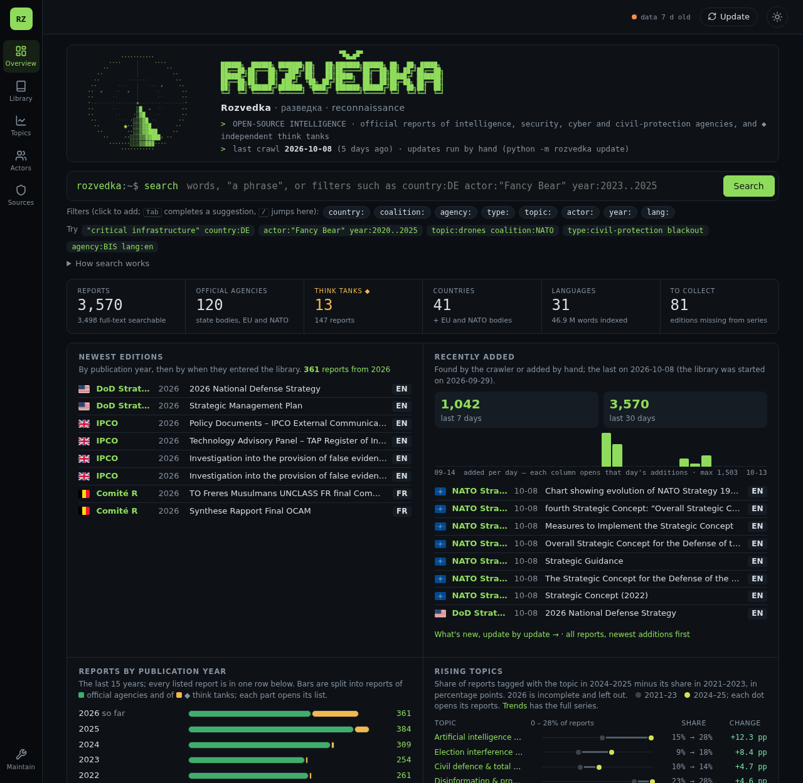

</div>

## About

Intelligence services, cyber-security centres, civil-protection authorities and police agencies publish annual
reports, threat assessments and risk analyses. Rozvedka gathers them from the agencies' own websites into one
local library, so you can follow how state security, social resilience and disaster preparedness are developing
– and who reports on what.

| | |
|---|---|
| **Coverage** | 163 agencies and institutions and 19 independent think tanks in 50 countries and bodies: 26 EU member states, EU bodies and NATO, every NATO member except Montenegro (Iceland, Albania, North Macedonia, Türkiye, the UK, Norway, the USA, Canada), Switzerland, Ukraine, six Latin American countries, Australia, New Zealand, Japan, South Korea and Taiwan |
| **Library** | about 4,400 reports in 32 languages, with archives back to 2000, downloaded as PDF |
| **Index** | full text of every report, 66 topics from a 4,400-term multilingual keyword list, about 1,550 named actors and 189 countries |
| **Runs on** | a Raspberry Pi (or any Linux box) – Python, SQLite and the browser; no cloud service, no account |

> [!IMPORTANT]
> **Everything is traceable.** Every number on every chart opens the list of documents it counts; every actor
> mention links to the page of the PDF it was found on; every external fact (an event date, a Wikidata
> designation, a Wikipedia summary) carries its source, revision and retrieval date. Nothing is estimated or
> generated – counts are counts of documents.

## Features

**Finding your way.** The side rail has six groups – *Overview*, *Library* (documents, what's new, series, watchlist), *Topics & trends*,
*Actors & threats* (actors, connections, sanctions, attributions, threat levels, CVEs, ATT&CK techniques), *Sources* (agencies, think
tanks, maps, ratings, citations) and *Maintain* (update, coverage, upkeep, data exchange). Hover a group for its pages, each with a
line on what it answers; tabs under the command bar show the section you are in, and the command bar (`rz>`) searches from every page. **All views** (`/views`) lists every page with the
number it holds. On a phone the groups open from one Menu button.

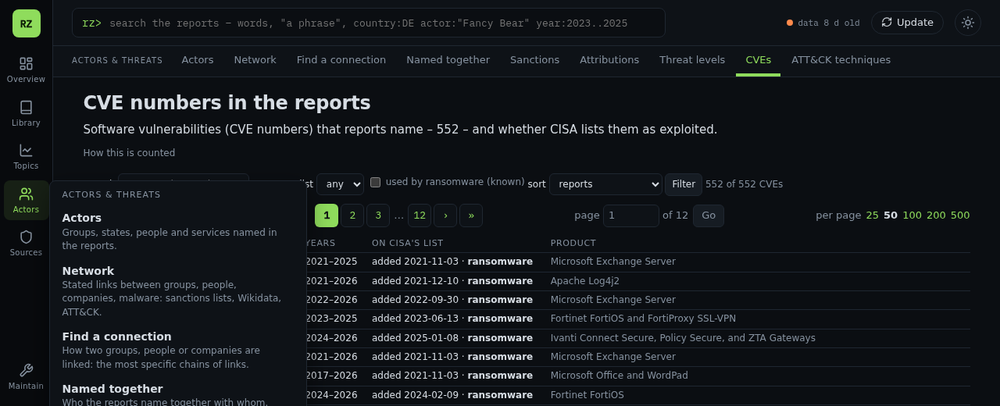


### 🛰️ Home – search console and dashboards

The start page (`/`): an ASCII radar and word mark, one search box for the whole library, and what is new.

- **Search console** – type words, `"a phrase"`, or filters: `country:DE`, `coalition:NATO`, `agency:BIS`,
  `type:cyber`, `topic:ransomware`, `actor:"Fancy Bear"`, `year:2020..2025`, `lang:de`. The search opens the
  Documents list with those filters set. A misspelt or ambiguous filter is explained, with the choices as links
  (`agency:BIS` → BIS in Czechia or Slovakia).
- **Suggestions as you type** – actors (by any of their names, e.g. `APT28` → Fancy Bear), topics, agencies and
  countries, each with the number of reports it lists. <kbd>↑</kbd>/<kbd>↓</kbd> choose, <kbd>Enter</kbd> opens,
  <kbd>Tab</kbd> puts the suggestion into the query as a filter, <kbd>/</kbd> jumps to the box. Recent searches
  are remembered in your browser only.
- **Key numbers** – a strip under the search: reports, official agencies, ◆ think tanks, ■ commercial analysts, countries, languages and editions to collect.
  The report, think-tank and analyst tiles carry a sparkline of their reports by publication year over the last 15 years
  (the current year paler, as it is not over); each bar opens that year's list.
- **Dashboards** – one grid of panels: newest editions; reports added lately, with a column for each of the last 30 days (a column opens
  that day's additions); reports per publication year, each bar split into official agencies, ◆ think tanks and ■ commercial analysts (every
  report in one row, undated ones included); rising topics as a dumbbell – each topic's share in the earlier and the
  recent period, both dots opening their reports; the actors most named in last year's reports; the library by
  agency type (bars in the type's colour) and download state, with the editions still to collect; the threat watch (the CVE numbers and
  ATT&CK techniques the reports name most); and when the data
  was last crawled. Every number and every bar part opens the list it counts.

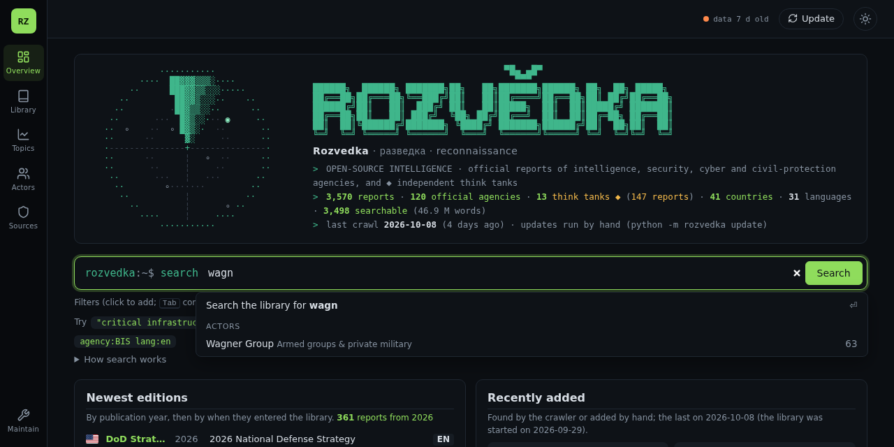

### 🆕 What's new – update by update

`/new` shows what each update brought; an update is a day on which reports entered the library (updates run on
demand).

- **New reports** by agency, each with its main topics and the actors it names most.
- **Named for the first time** – actors named in the update's reports and in no report found earlier.
- **Topics that jumped** – each topic's share of the update's reports against its share of the reports found before.
- An **Atom feed** (`/feed.atom`) of the newest reports with their topics, actors and official URL, for any feed
  reader on your network.

Every number opens the list it counts.

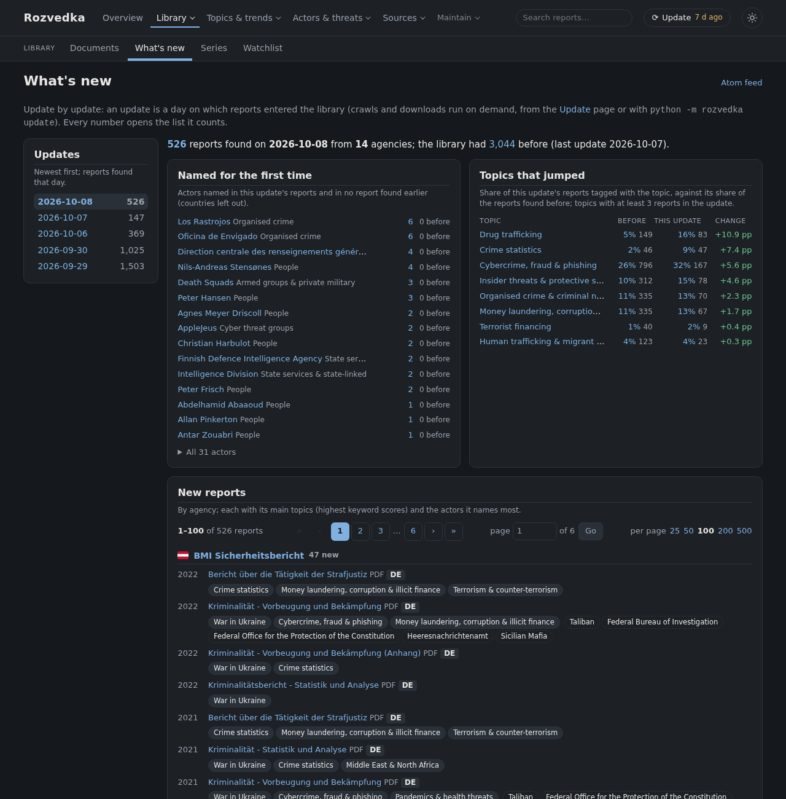

### ☆ Watchlist

`/watch` follows searches **update by update** – one list for the whole portal (no accounts, no per-browser state),
kept in [`sources/watchlist.yaml`](sources/watchlist.yaml) (written by the portal, editable by hand). An item is any
search-console query: `actor:"Wagner Group"`, `topic:ransomware country:DE`, `"critical infrastructure"`. Add one with
the box on the page, **☆ Watch this search** on the Documents list or **☆ Watch** on an actor page.

- **Reports per update** – a table of the watched searches × the latest updates (with the earlier ones summed), each
  cell the number of the item's reports that entered the library that day.
- **By update** – newest update first, which watched searches it brought reports for.
- Per item: its newest reports, each with its passage on the search (densest mentions or terms) and page, and an
  **Atom feed** of the item (`/feed.atom?watch=…`).

Every number opens the Documents list of exactly those reports.

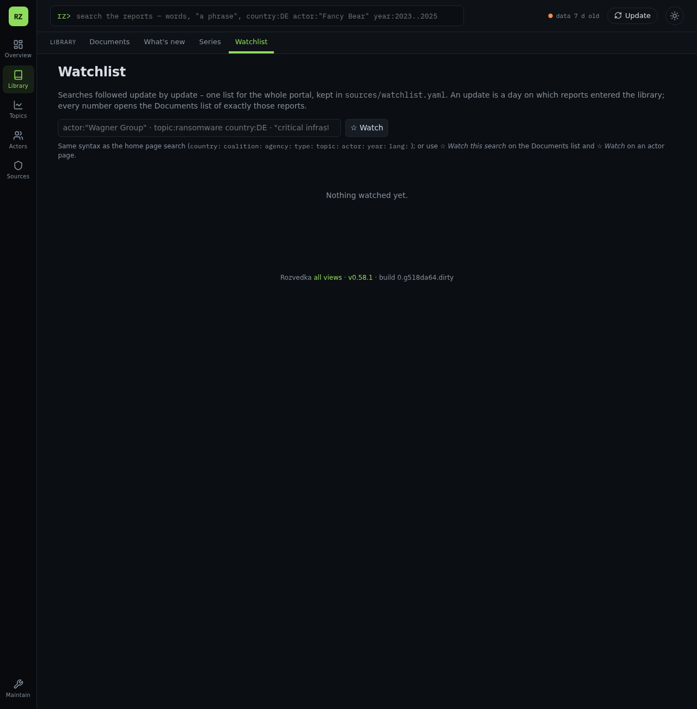

### ⚖️ Compare agencies

`/compare` puts what agencies say about **one actor or one topic** side by side: one card per agency, ranked by how
many of its reports in the chosen years name the actor (or are tagged with the topic), with the agency's two reports
that deal with it most and, from each, the **densest passage** – the 600 characters with the most mentions or topic
terms, passing over reference lists and endnotes – with its page in the PDF. Filter by years, country, coalition and
agency type; start from the menu, an actor page (*compare what agencies say*) or the Topics page (*compare*).

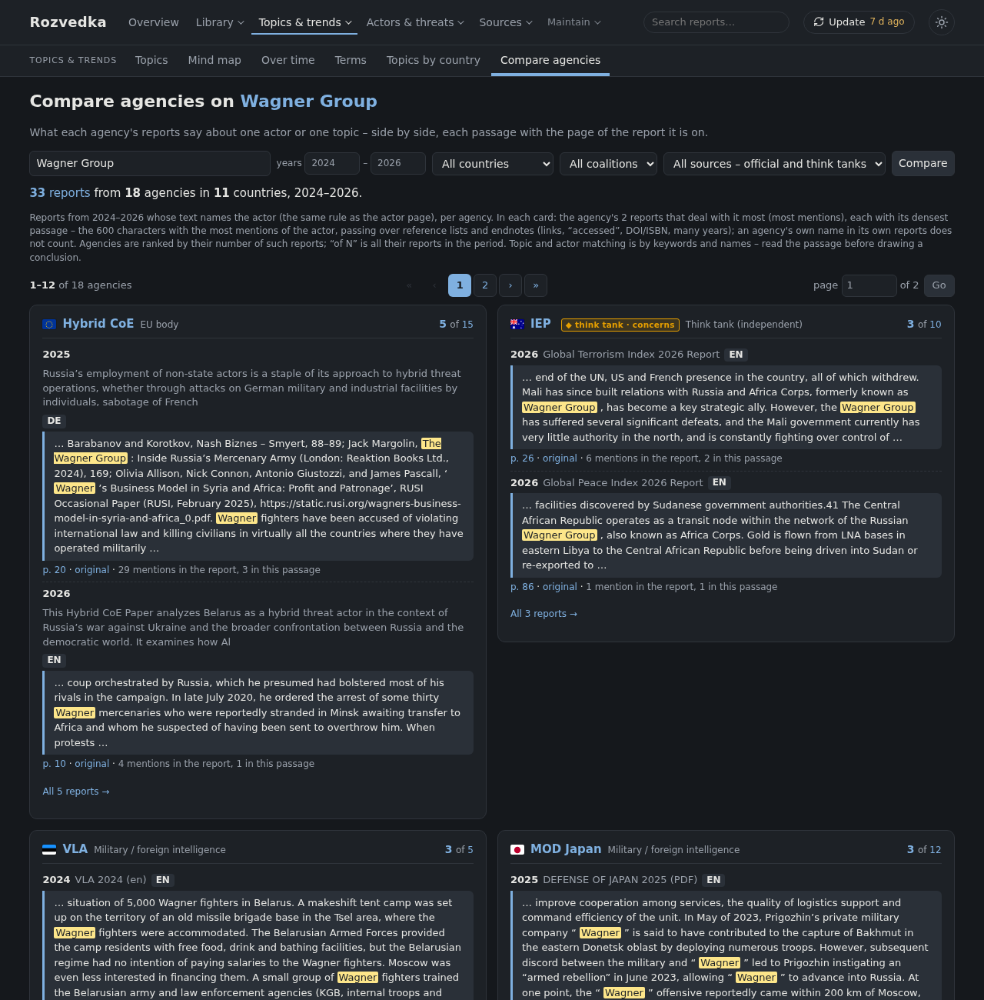

### 📚 Documents

The library itself (`/documents`): every report with its agency, country, language, year and topics.

- Filter by country, coalition (EU, NATO, Five Eyes, G7, Schengen, AUKUS, JEF, NATO IP4), agency type, language,
  year or year range, download status, topic (several at once) and actor.
- **Full-text search inside the reports** – `"quoted phrases"`, `OR` for your own alternatives, results with
  highlighted snippets, sorted by relevance, year or date added.
- **Cross-language search** – a word that names one of ~100 security concepts (`sources/concepts.yaml`) also finds
  its names in the other languages of the library: *Drohne* finds 449 reports instead of 25 (drone, dron, дрон,
  bezpilotní letoun, mehitamata õhusõiduk …). The names are the labels and aliases of the concept's Wikidata item,
  shown above the results with the item, its revision and the retrieval date; *Search only the words as typed* turns
  it off. Trends term charts stay literal.

  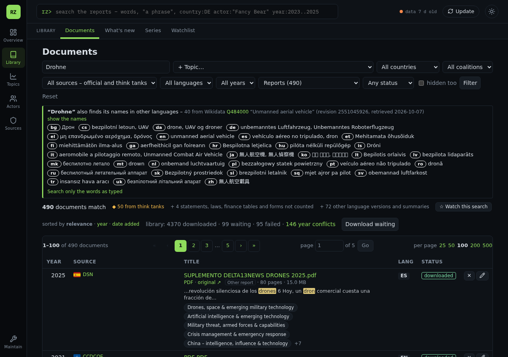
- Open a report's own page (its title), the downloaded PDF, or the agency's original; correct a title, language
  or year; hide irrelevant files; add a document by URL for sites that block automatic downloads.
- Page through the results with numbered pages, first/last, "go to page", and 25 / 50 / 100 / 200 / 500 per page –
  the same pager on every list in the portal (actors, names, passages).
- **Reports, not files** – the language versions, summaries and file variants of one report are grouped and counted
  once: the edition of a yearly series in any language, the same address with another language marker (`_en.pdf` /
  `_de.pdf`, `/en/` / `/fr/`), or the same title with a language or "summary" ending ("TE-SAT 2025 – Zusammenfassung").
  The file with most text represents the report (English unless another version has 30 % more); each row lists the
  other files ("also de fr …"), and the report page shows them all with the rule that grouped them. Asking for a
  language, a series or *all files* lists every file. Mistaken groups are split in `sources/works.yaml`.

  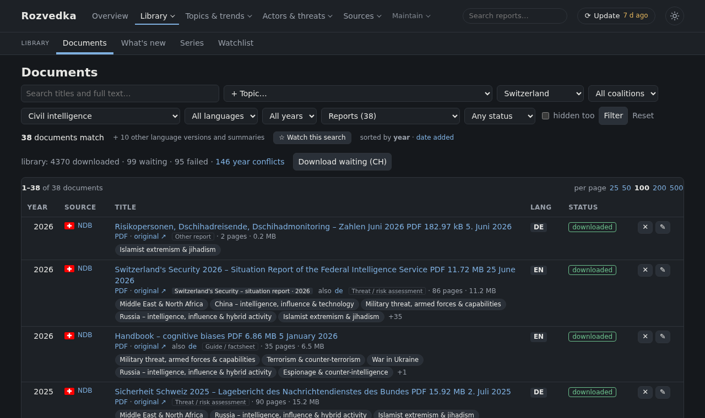

- **Document types** – every file is typed by transparent rules on its title and file name (in the library's
  languages), its report series and its page count: annual or periodic report, threat / risk assessment, strategy,
  bulletin, guide, other report – or **not a report**: statement / press release, law or regulation, budget table, form. The type and
  the rule behind it are on each row and on the report page, where it can be corrected by hand
  (`sources/doc_types.yaml`). Statements, laws, budget tables and forms stay in the library but are left out of every
  count, chart and dashboard, as hidden files are; the Documents list says how many it leaves out and shows them with
  the type filter. Sampled precision: 48 of 50 types right.

  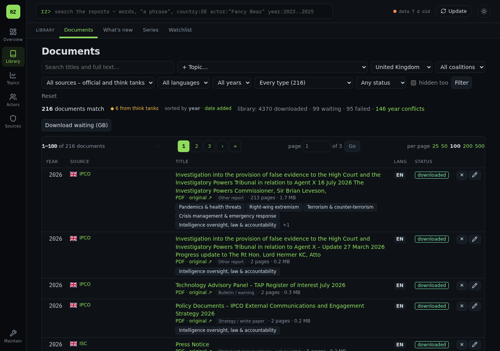

- **Year conflicts** (`/years`, linked from the Documents summary): reports whose stored year is contradicted by strong
  evidence – a Japanese era year in the title, a date stamp in the file name, a report heading on the cover naming
  another year – with the evidence and one click to use the year found or keep the stored one. Nothing changes
  without a verdict; verdicts are kept in `sources/year_reviews.yaml` and travel with datasets.

  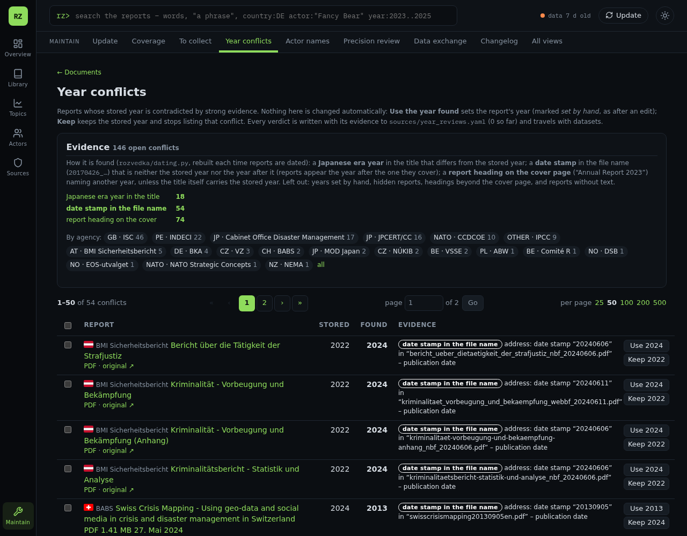

### 📄 Report page

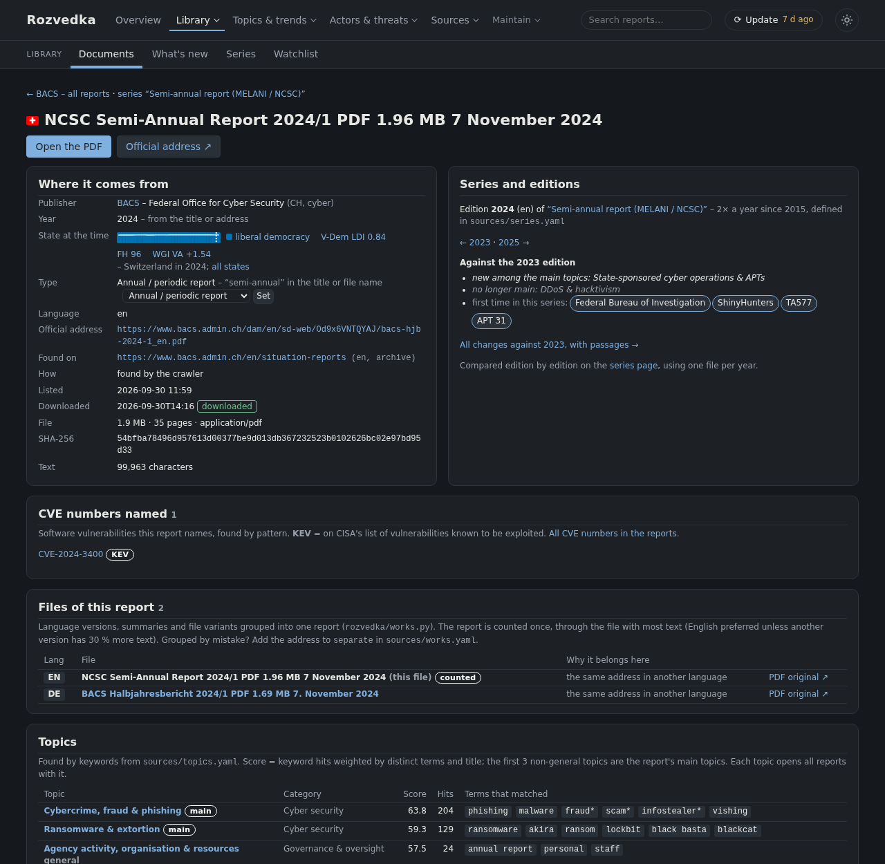

Every report title in the portal opens its own page (`/report/<id>`); the PDF stays one click away:

- **where it comes from** – agency, the document type and the rule that set it, the official address, the page it was found on, how it got into the library
  (crawler, address pattern, by hand), when it was listed and downloaded, size, pages, SHA-256, and whether its text
  came from OCR; how its year was found;
- **series and editions** – which edition of which series it is, the previous and next edition, the same edition in
  other languages, and what changed against the previous edition (topics new or no longer among the main ones,
  actors named for the first time in the series), with a link to the full comparison;
- **topics** with their score and **the terms that matched**, so every topic tag can be checked;
- **actors named**, each with its first passage and page number, and the countries named.

#### Edition changes

Any two editions of a series can be compared (`/series/<id>/changes`, from the series page or a report's "Against the
previous edition" box): actors named for the first time or no longer, each with its passage and page, actors named
clearly more or less often, and topics that are new, gone or now (no longer) among the main ones, with their scores.

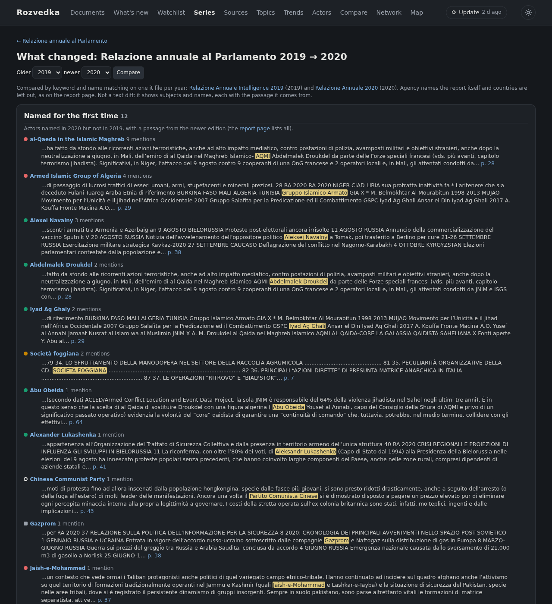

### 🏛️ Sources

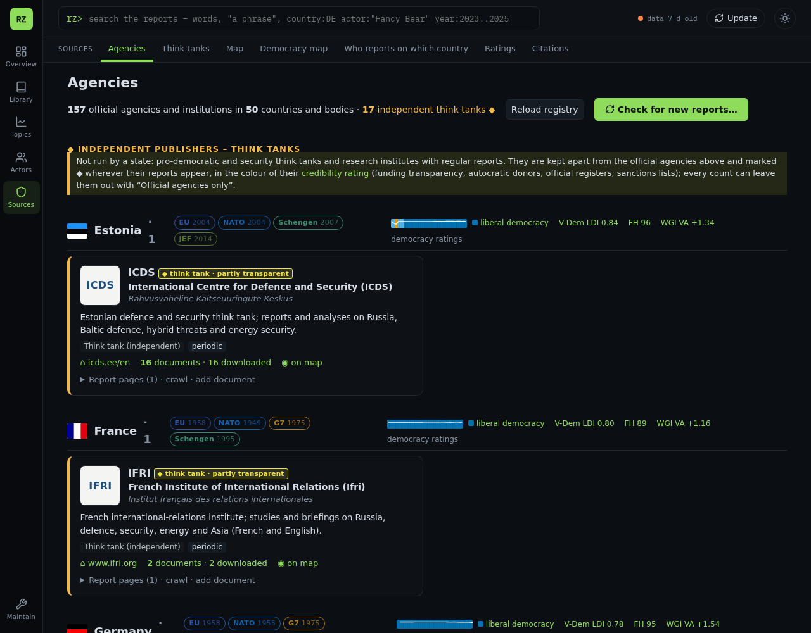

**Official agencies and independent publishers are always told apart.** Besides the state agencies and
intergovernmental bodies, the library includes pro-democratic and security **think tanks** – CEPA, Freedom House,
ISD, ECFR, V-Dem, SIPRI, ICCT, Clingendael, HCSS, IFRI, ICDS, ASPI, Lowy Institute, IEP; CSIS, ISW and GLOBSEC
collected by hand. They are marked **◆ think tank** wherever a source or report appears (Documents, report page,
home, What's new, Watchlist, Compare, Series, actor pages), have their own section on Sources, a yellow diamond
instead of a dot on the map, and every count can leave them out with **“Official agencies only”**; the Trends notes
and the Documents summary say how many think-tank reports a count includes.

**■ Commercial analysts** are a third kind: companies that sell political-risk, security or threat analysis to clients
and publish part of it openly – Eurasia Group (Top Risks), ESET (Threat Reports, APT Activity Reports), Graphika
(influence-operations investigations) and Microsoft's Digital Defense Report; the Allianz Risk Barometer and Munich Re's
natural catastrophe figures are collected by hand. They are marked ■ (a dashed badge, a square on the map), have a
section of their own on Sources and on the credibility page, and are counted apart from both agencies and think tanks
on the home page, in Documents, in Trends and in every year bar.

One card per agency: flag, logo, official name in the original language and in English, home page, a short
description of what its reports cover, coalition tags with the year each country joined, the report pages it is
crawled from (with language and current/archive), and a link to its headquarters on the map.

### ◆ ■ Think tanks and commercial analysts – credibility profiles

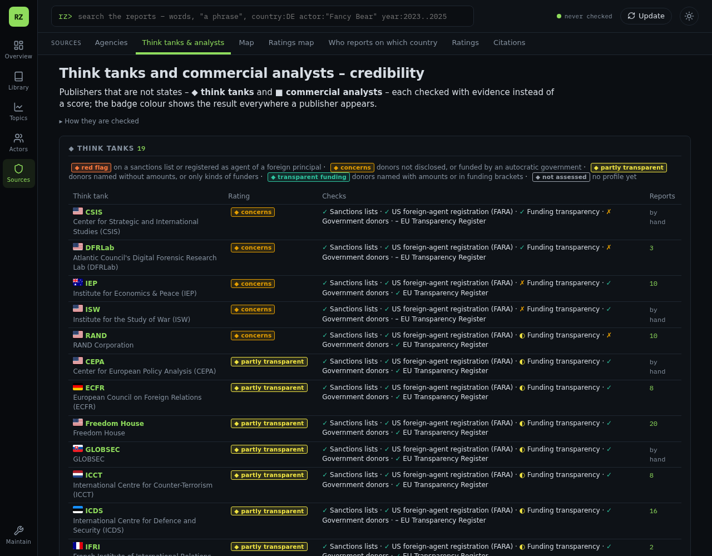

No current, credible ranking of think tanks exists, so each think tank gets **checks with evidence instead of a score**
(*Sources → Think tanks*, `/publishers`): how openly it discloses who funds it (Transparify's scale: amounts, brackets,
names, categories, none – researched by hand with the evidence link and date, `sources/publishers.yaml`), whether a
donor government is an autocracy (V-Dem), its **EU Transparency Register** entry, **US foreign-agent (FARA)**
registrations, and the **sanctions lists of the US, UK, EU and UN** (fetched: `python -m rozvedka fetch-publishers`).
The result – *transparent funding*, *partly transparent*, *concerns*, *red flag* – colours the ◆ badge wherever the
think tank appears and its diamond on the map, with the reason in words. Each think tank has a **profile page**: the
checks and their evidence, former Transparify ratings, identity from Wikidata and Wikipedia, its state's democracy
ratings, and its reports here – per year, main subjects, actors named most, latest reports.

A **commercial analyst** is rated by **who owns it** – a listed company or owners named with their stakes (*transparent
ownership*), owners named without stakes (*partly transparent*), owners not disclosed or a stake held by an autocracy's
state (*concerns*) – and whether it names clients; for both kinds, whether **authors and a method** are published, and the
**US federal contracts and grants** it received by awarding agency since FY2008 (USAspending.gov, counted only for the
exact recipient names in its profile; information, not a fault). Every profile lists the publisher's **owners, sponsors and
ties** – founders, leaders, investors, partners, donor governments, the US agencies that paid it and the owner, funder and
leaders on its Wikidata item – each with its evidence; the same ties are links of the **network** (layer “Publisher
profiles”), so a path search can show who stands behind the publisher of a report.

### 🗳️ Ratings of the reporting states – democracy, security, governance

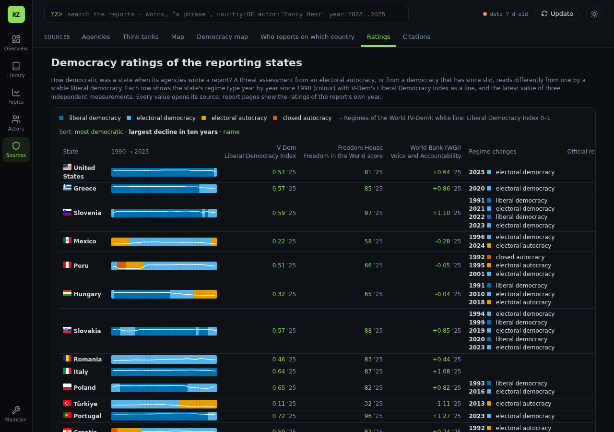

A report reads differently if its state has since slid from democracy (*Sources → Ratings*, `/ratings`):
each state's **regime type year by year since 1990** (V-Dem Regimes of the World, colour) with the **V-Dem Liberal
Democracy Index** as a line, plus the latest **Freedom House** score and the **World Bank Voice and Accountability**
indicator – three independent measurements, each value linked to its source, with licence and retrieval date. Sort by
the largest decline in ten years. Country headings on *Sources* carry the same strip, and every **report page shows the
ratings of the report's own year** – with a warning when the state's regime type has changed since (e.g. Hungary 2010
electoral democracy, 2018 electoral autocracy).

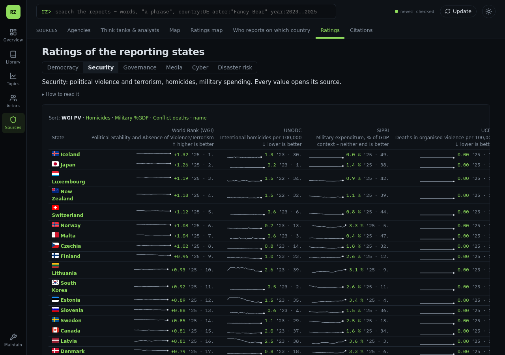

Two more groups sit beside democracy. **Security**: the World Bank's *Political Stability and Absence of
Violence/Terrorism*, UNODC's **intentional homicides** per 100,000 and SIPRI's **military expenditure** as a share of GDP
(context, not a grade). **Governance**: the World Bank's *Rule of Law*, *Control of Corruption*, *Government
Effectiveness* and *Regulatory Quality*, and Transparency International's **Corruption Perceptions Index**. Every column
shows the state's course since 1990 on the measure's own scale, its latest value and year and its place among the
library's states, and says which end is better. Nothing is combined into a score. From the library's own event data
come UCDP **deaths in organised violence** per 100,000 (security) and EuRepoC **cyber incidents** reported against each
state (a *Cyber* group; each count opens those incidents). *Disaster risk*: the EU JRC's **INFORM Risk Index** (one release with
every year recomputed alike) and the **WorldRiskIndex**. *Media*: RSF's **World Press Freedom Index** since its 2022
method. *Cyber* also shows each state's tier in the ITU **Global Cybersecurity Index 2024** (T1–T5), read from the
annex of the report.

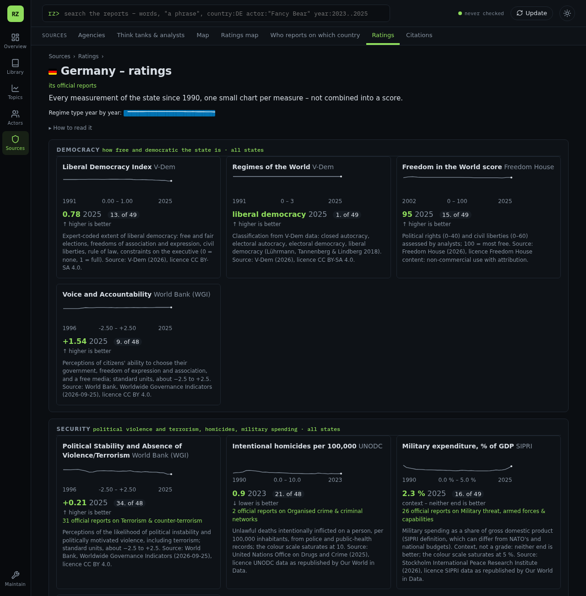

A state's name opens **all of its ratings** (`/ratings/DE`): one small chart per measure, with the latest value, its
place, the source and licence, and – where a topic matches – the state's official reports on it (terrorism beside
political stability, organised crime beside homicides, corruption beside the corruption measures). Data:
`python -m rozvedka fetch-ratings` (also part of `fetch-actors`).

### 📅 Report series

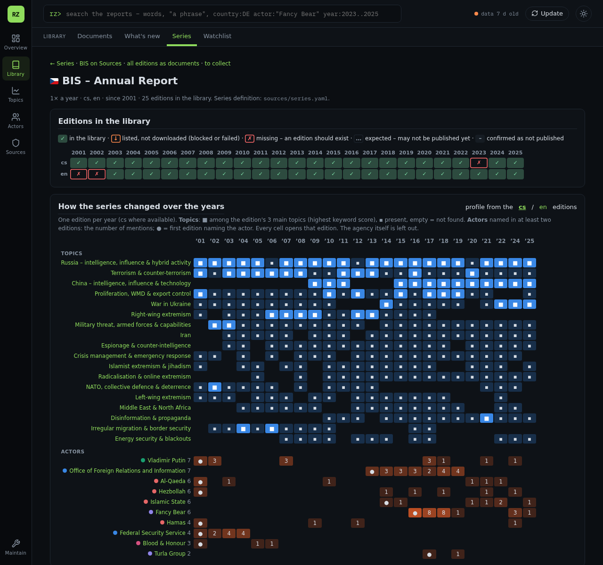

Recurring publications – the BIS annual report in Czech and English, KAPO's annual review, the Verfassungsschutzbericht – read
**edition by edition** (*Series* in the menu):

- the **catalogue** of all series with how complete each is, its latest edition and a compact grid of the last years;
- a **page per series**: which editions the library has per year and language (✓ in the library, ↓ listed but blocked,
  ✗ missing, … expected, – not published); **how the series changed** – its main topics and the actors it names, year by
  year (topics × years and actors × years, every cell opens the edition); and **edition by edition** what each one is
  mainly about, whom it names most, what became or stopped being a main topic, and which actors appear for the first time;
- documents carry a badge of their series (*Annual Report · 2023*), and the documents list filters by series.

The library proposes series from recurring titles; confirm, rename, merge or reject them on *Sources → Coverage*
(stored in [`sources/series.yaml`](sources/series.yaml)), which also lists every series' gaps for maintenance.

### 🧩 Coverage grid – where the library is thin

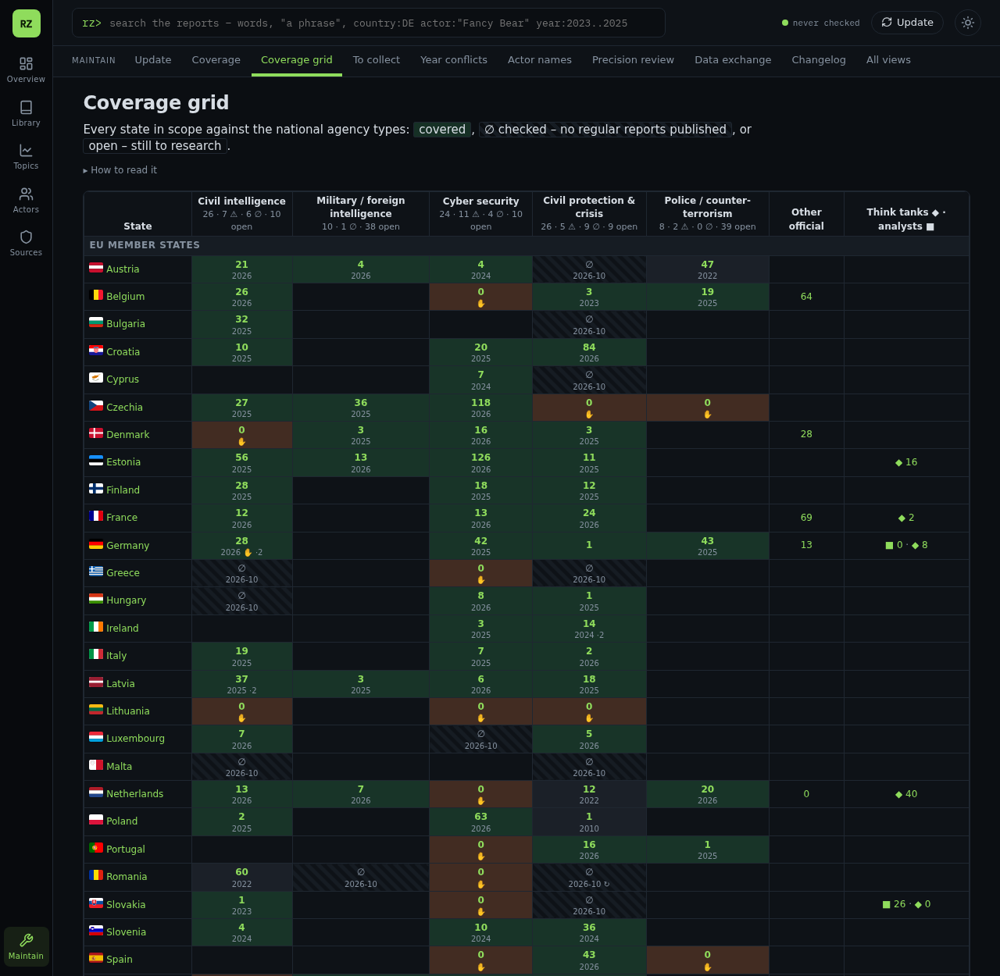

`/sources/grid` (Maintain → Coverage grid) puts every state in scope against the five national agency types: civil
intelligence, military/foreign intelligence, cyber security, civil protection, and police/counter-terrorism.

- **Covered cells** give the reports of the state's agencies of that type (the number opens them), the newest year (grey when
  older than three years) and ✋ where the site is collected by hand.
- **0** marks a source that is listed but has no report yet. Most of these are bot-protected sites waiting on *To collect*.
- **∅** marks a slot that was researched without finding regular public reports, such as Greece's intelligence service or
  Malta's civil protection. The date and what was found are kept in [`sources/coverage_gaps.yaml`](sources/coverage_gaps.yaml).
- **Empty cells** are open: the page lists them as the slots still to research.
- Other official bodies and the state's think tanks ◆ and commercial analysts ■ are counted in separate columns. Every
  number is checked against its list by `tools/check_links.py`.

### 📥 To collect – hand import with provenance

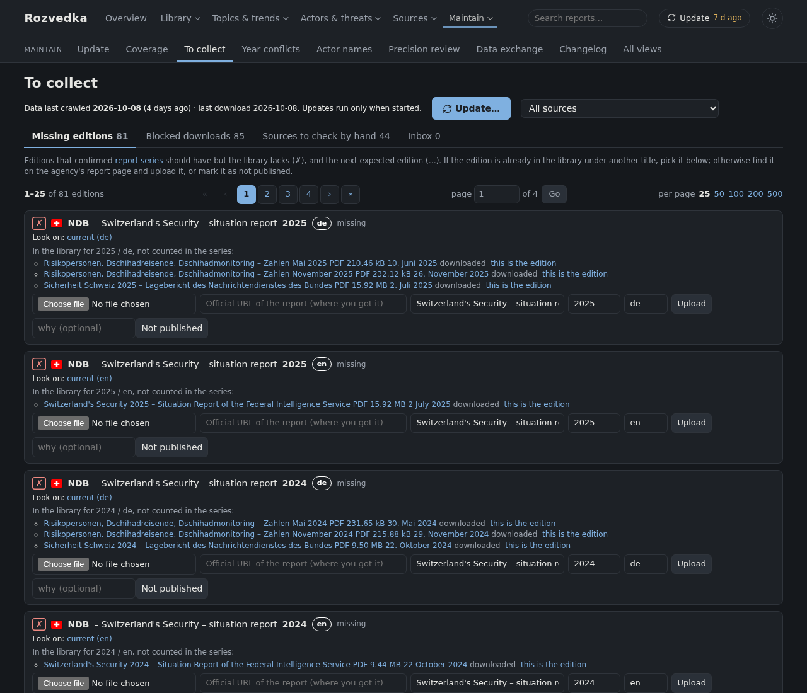

What the crawler cannot fetch, in four tabs: **missing editions** of confirmed series (with the source's documents of that
year and language to pick as the edition, an upload form, or "not published"), **blocked downloads** (sites that hand the PDF
only to a browser – open the original, save it, upload it to the same report), **sources to check by hand** (bot-protected
sites with their report pages and the date you last checked) and the **inbox** (PDFs copied to `data/inbox/`, imported with a
short form). Every report added by hand keeps its official URL, the date it was added and whether that URL is on the
agency's official domains (marked *added by hand* in the documents list, with a warning when it is not); it is indexed for
search, topics and actors right away. New reports from the agencies' sites are found on the **Update** page – there is
no periodic job.

### 🏷️ Topics and full-text index

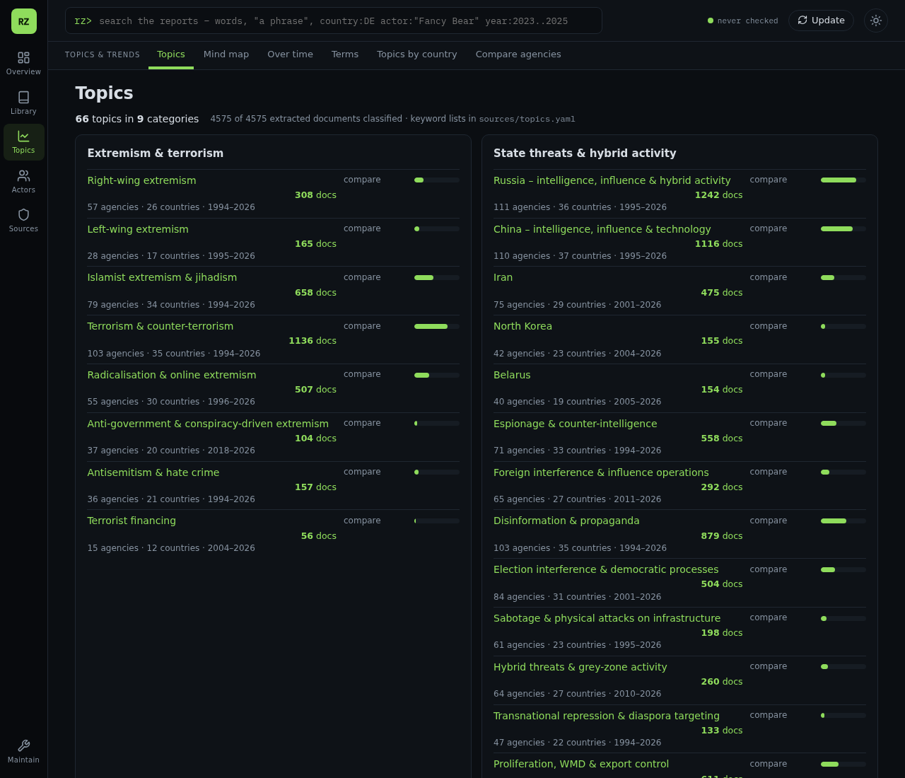

- 66 topics in 9 categories – extremism, state threats, geopolitics, cyber, crime, migration, hazards,
  resilience, governance – e.g. *right-wing extremism*, *Russia – intelligence, influence & hybrid activity*,
  *drones & emerging military technology*, *floods & extreme weather*, *civil defence*.
- Each topic is defined by keywords in 28 languages in [`sources/topics.yaml`](sources/topics.yaml); a report gets
  a topic only when it mentions it substantially, not in passing.

### 📋 Briefings – one topic or one country on one page

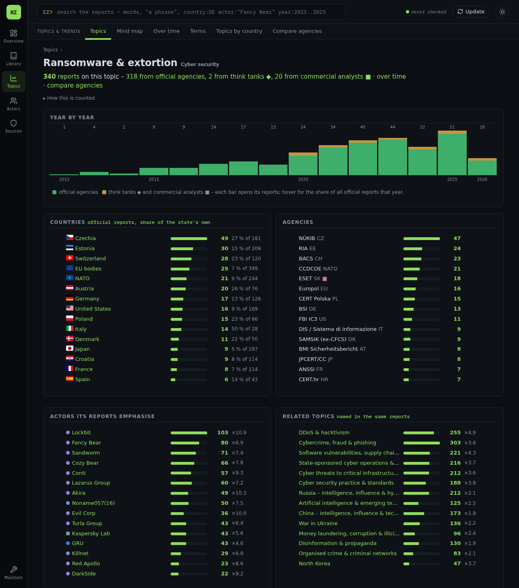

- **A topic** (`/topics/ransomware`, opened from the Topics page) shows:
  - its reports year by year, official agencies apart from think tanks ◆ and commercial analysts ■;
  - the countries writing most about it, with the share of each state's own reports;
  - the agencies writing most about it;
  - the **actors** and **related topics** its reports emphasise, ranked by lift × reports: how much more often than all
    reports, so neither the names every report mentions nor one-off mentions come first. For ransomware these are LockBit,
    Fancy Bear, Sandworm, Conti and Akira;
  - its newest reports, with the words that tagged them.
- **A country** (`/countries/DE`, Sources → Countries) shows:
  - its agencies and their reports year by year;
  - the topics and actors its official reports emphasise compared with all official reports. Its own agencies are left out,
    since they name themselves. For Germany these are crime statistics, anti-government and conspiracy movements, and
    antisemitism, and the Reichsbürger, AfD and Die Heimat;
  - which other states' reports name it;
  - its regime type, ratings, events and threat levels.
- Every number opens the Documents list it counts. `tools/check_links.py` compares two sample briefings with their lists.

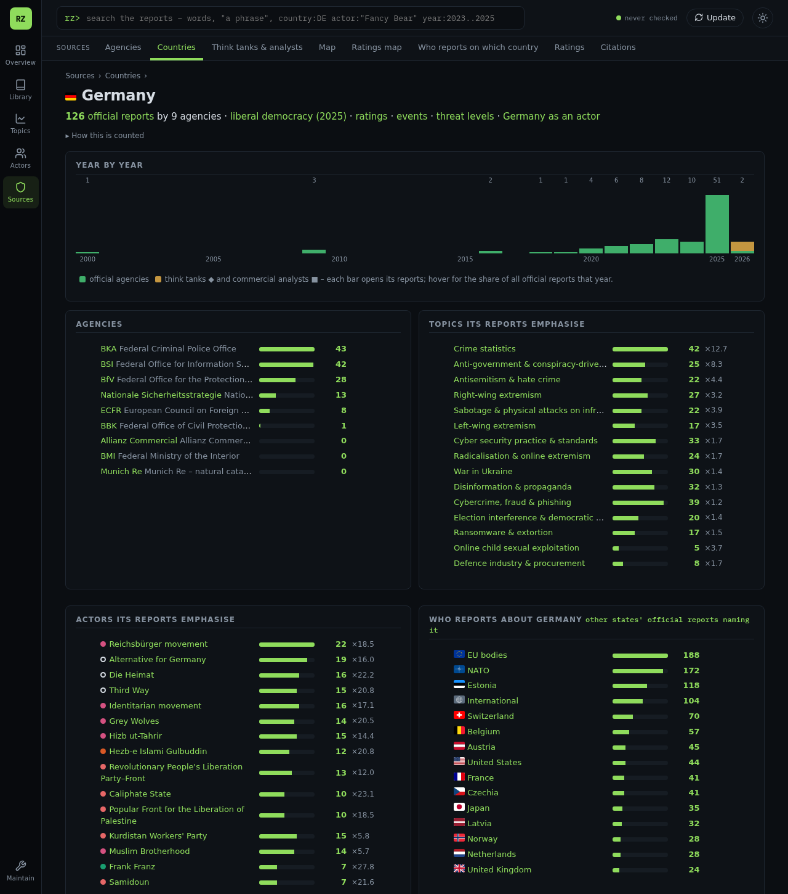

### 📈 Trends

<table>
<tr>
<td width="50%">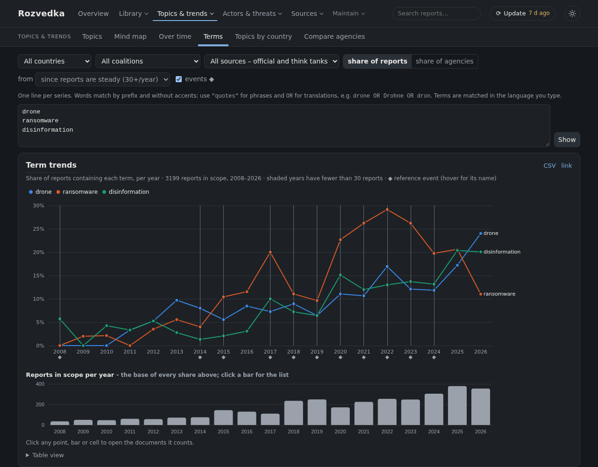</td>
<td width="50%">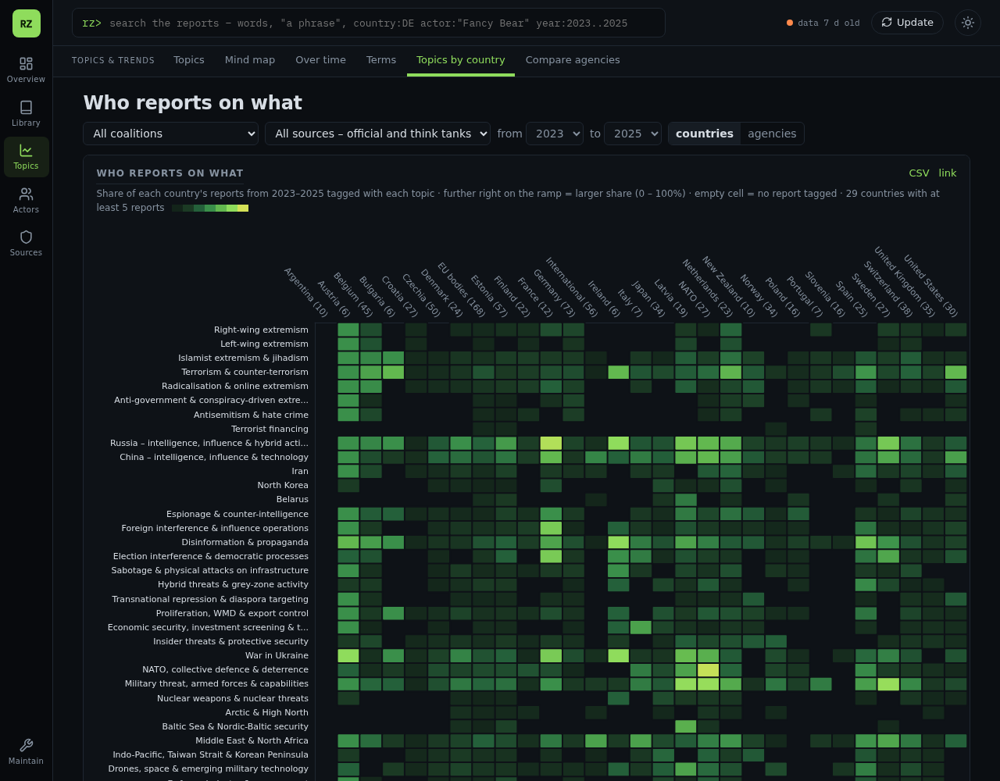</td>
</tr>
<tr>
<td><b>Term trends</b> – any words over time, one line per term, with translations joined by <code>OR</code>.</td>
<td><b>Who reports on what</b> – countries or agencies × topics for a period, with all reports of the period as the first
column; <i>over-emphasis</i> shows how much more or less often a row carries a topic than all reports (¼× blue … 4× yellow).</td>
</tr>
</table>

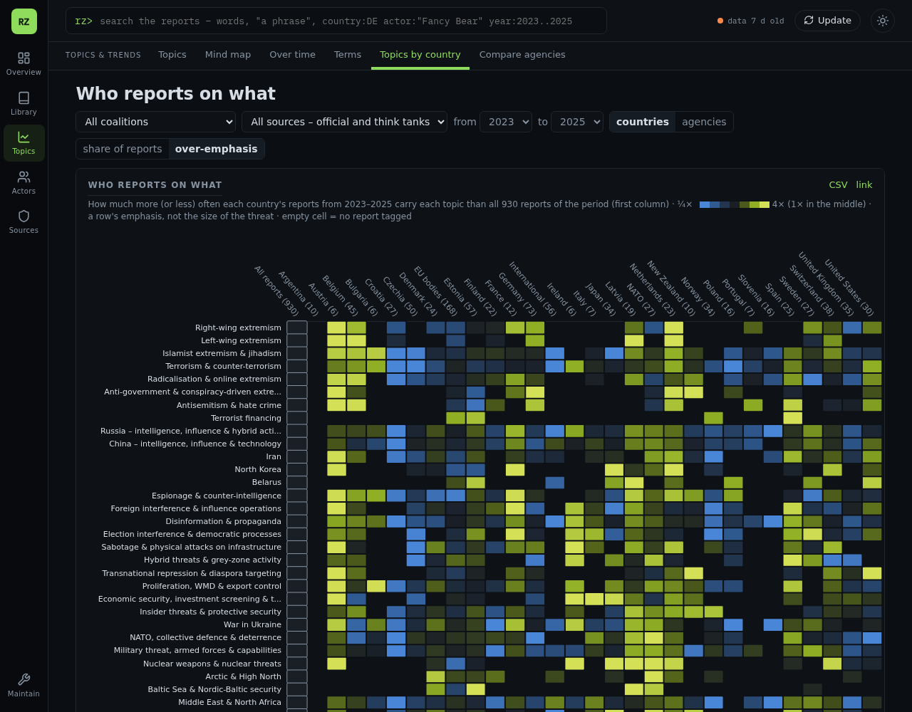

- **Topics over time** – share of reports (or of reporting agencies) per year for up to 8 topics, with the number
  of reports per year beneath, plus the topics that rose and fell most in the last two years.
- **Reference events** (9/11, the annexation of Crimea, COVID-19, the invasion of Ukraine, …) marked on the time
  axis, dated from Wikidata.
- Every view has a permalink, a table view, a CSV export with a source link on every row and a *Where these
  numbers come from* section (method, filters, excluded documents, taxonomy version).

### 🕵️ Actors

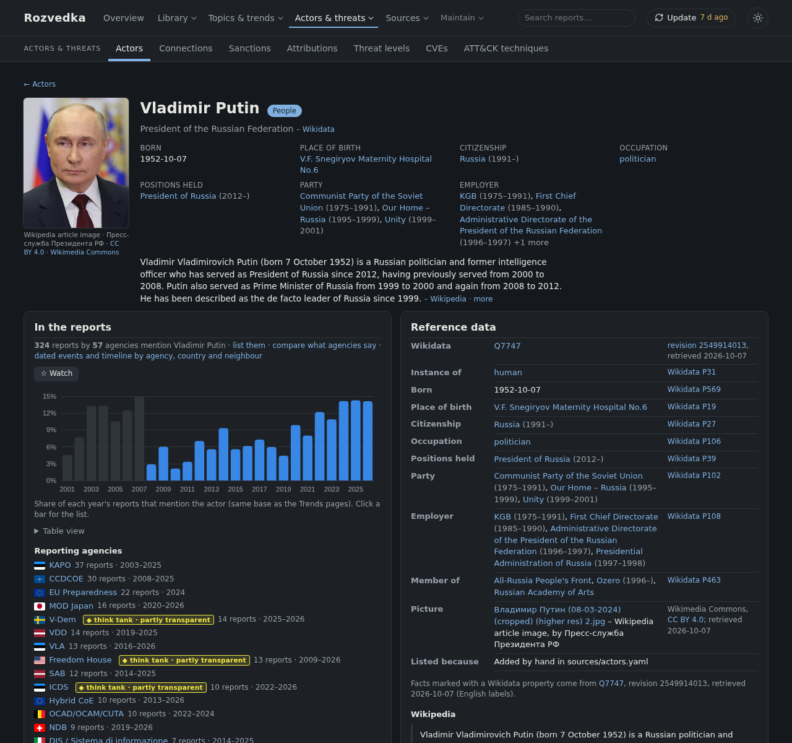

- An index of state services, cyber threat groups, terrorist-designated and armed groups, organised crime,
  movements and key people, built from **Wikidata**, **Wikipedia** and **MITRE ATT&CK**, and found by name in the
  report texts – in all report languages and with the aliases of each group (APT28 = Fancy Bear = Sofacy =
  Forest Blizzard).
- **Profile** at the top of each actor page: a picture – a group's flag or logo, a person's photo, a country's
  flag – with its author and licence from Wikimedia Commons, key facts from Wikidata (born, positions held,
  citizenship; founded, founder, leader, ideology, headquarters, members) each linked to its statement, and the
  opening of the Wikipedia article. Fetched with `fetch-actor-profiles` (part of `fetch-actors`) for every actor
  the reports name; only freely licensed pictures are used, stored once as small thumbnails.
- Each actor page: reference data with its source and revision, the Wikipedia lead, mentions per year, which
  agencies report on it, the topics of those reports, actors named in the same passage, and **the passages
  themselves with a link to the cited page of the PDF**.
- **Actor timeline** (`/actors/<key>/timeline`, the last card of the key-number strip on every actor page) – one year axis
  for everything: a lane of **dated events** (◆ sanctions list, ▲ official attribution, ■ terrorist designation, ● founding),
  the reports naming the actor each year as bars, and the reporting countries as a heat grid below. Then panels: the dated
  events with their sources and quotes; the actors named in the same passage, each with small yearly bars (marked **new** or
  **gone** when they appeared or vanished in the last three years); and each agency's first-to-latest span, the dots opening
  the first and the latest report. Every cell, bar and dot links to the reports it counts.
- **Key numbers on the actor page** – reports, agencies, first named, most named year, official attributions and sanctions
  entries, each a link.

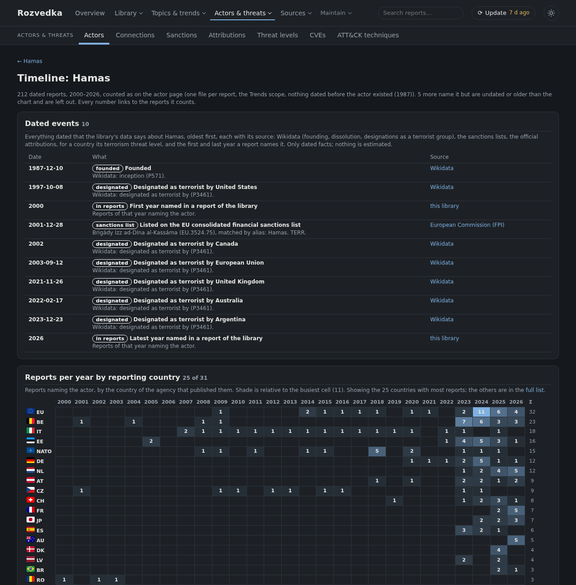

- **Official attributions** – government statements that name a cyber threat group and the state body behind it (UK NCSC,
  US CISA; 21 so far, hand-listed in `sources/attributions.yaml`). Every entry carries a verbatim quote that
  `fetch-attributions` re-checks on the published page; actor pages show them with issuer, date and the date of the last check.

- **CVE numbers and CISA's Known Exploited list** – every CVE the reports name, found by pattern (`index-cves`), tied to CISA's
  catalog of vulnerabilities known to be exploited (`fetch-kev`, CC0, version and retrieval date shown). `/cves` lists them
  with reports, agencies, years and the CISA entry; a CVE page shows the reports naming it with the passage and page and the
  actors named in the same passage (a nearness in the text, not a claim that the actor used it); actor and report pages show
  their CVEs. Every number links to the reports it counts. **How old the named flaws are**: for every report × CVE pair,
  the years between the year in the CVE number and the report's year (year precision – reports carry no exact date), and
  for CVEs on CISA's list whether the report named it before, in or after the year CISA added it; each bar opens the
  reports behind it.

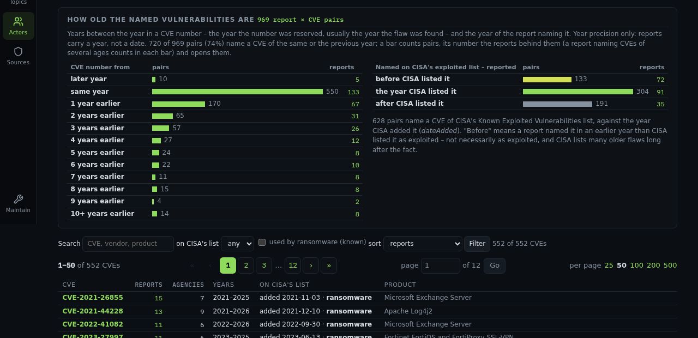

- **ATT&CK techniques** (`/techniques`) – the attacker-technique numbers (T1566, T1059.001 …) the reports name, tied to MITRE's
  catalog (`fetch-attack`, `index-techniques`): name, tactics, reports and agencies per technique, the passages, and the groups
  MITRE lists as using it (linked to the actor index). Report pages list the techniques they name; every count links to its reports.
  **The ATT&CK matrix as the reports name it** heads the page: a block per tactic in MITRE's order (the Enterprise kill chain,
  then what only ICS or Mobile has), the reports naming any of its techniques, and its techniques ranked by reports with a bar
  – how much of each tactic the reports cover ("8 of 46 named") at a glance.

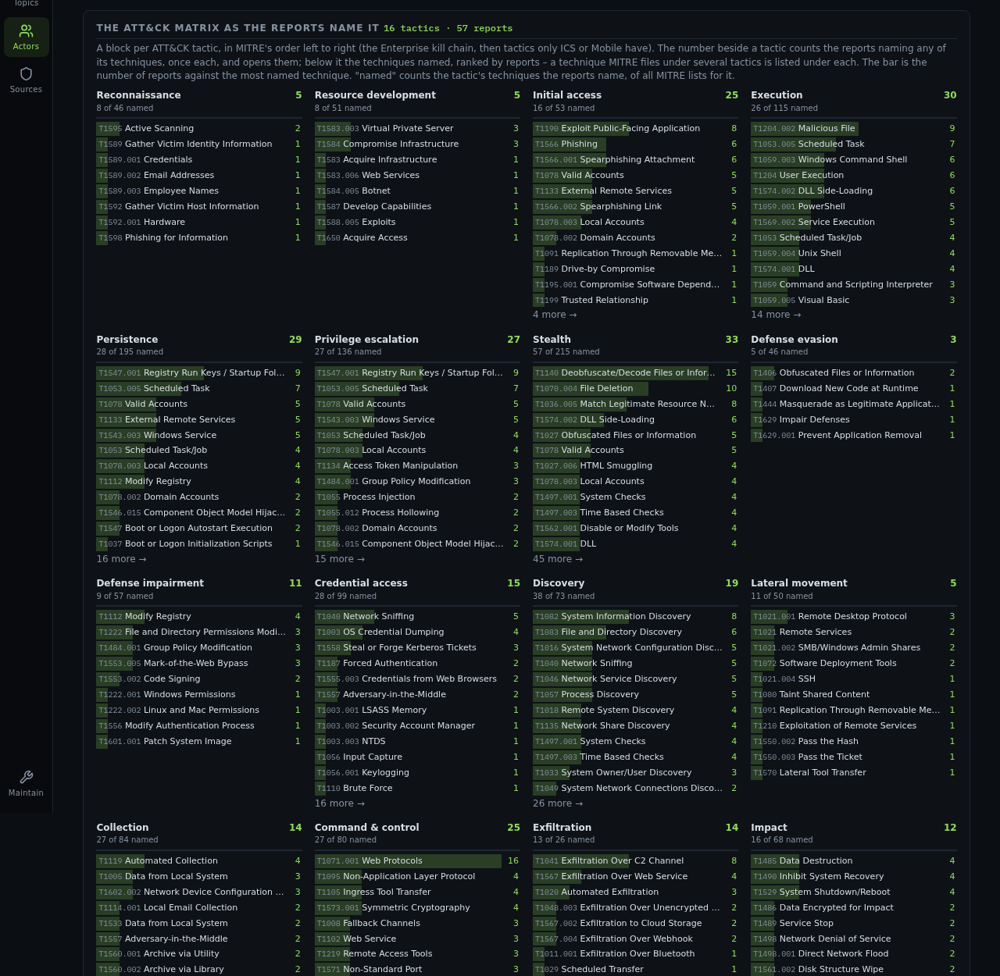

- **Terrorism threat levels** (`/threat-levels`) – small charts, one per state on its own scale and one shared time axis
  (announced changes as steps, levels read in reports as dots), then the levels states' services publish, as dated statements with the quote: the
  UK's official announcements of changes (MI5) and the levels that agencies' reports in the library state (Netherlands, Belgium,
  Spain, Austria, Sweden, Latvia), each on the state's own scale and with the page it comes from. Hand-curated; every quote is
  checked (`fetch-threat-levels` for the announcement pages, the library's stored text for the reports).

- **Books** (`/books`) – a local library of PDFs and EPUBs (`data/books/`, never committed or exported), read whole and
  matched to actors and topics like the reports, with their passages and pages – but of their own kind (▲ book) and never
  counted as reports. Metadata from a hand-written `books.yaml`, Open Library by ISBN (authors linked to Wikidata) or the
  file itself, each field with its origin (`import-books`). A book's page lists its chapters (bookmarks, EPUB table of
  contents or the printed contents page) with the actors named most in each, and its own index from the back, headwords
  linked to actors; passages are cited by the page number printed in the book (`index-books`).
  *What it says*, read from its text: each chapter's distinctive terms and three key sentences quoted with their page, every
  dated statement naming an actor (`/books/<id>/statements`), and – with the optional spaCy parser (`pip install -r
  requirements-books.txt`) – the relations its sentences state between actors, each with its sentence
  (`/books/<id>/relations`).

- **Timeline** (`/timeline`) – states and actors as lanes on one time axis: their events (Wikidata, EuRepoC, UCDP) and the library's
  dated records (sanctions listings, designations, official attributions, threat-level changes), UCDP's deaths per month as the lane's
  shaded background, and a row of the library's reports per year naming the subject (each year opens its list). At every zoom a lane
  draws only its heaviest events that fit and says how many it hides; clicking one shows its sources, participants and the relations
  its Wikidata item states. Full screen (`F`) and a wall mode (`W`) with larger type for big screens, sharp at 4K; the whole view lives
  in the address, so it can be opened on a TV as it is.

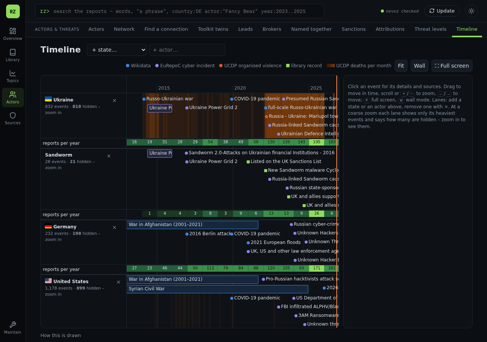

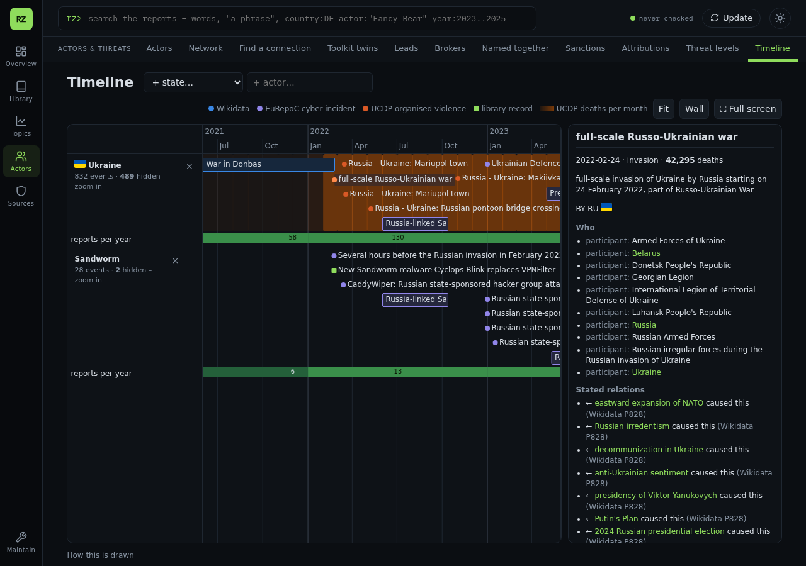

Clicking an event draws its **chain**: the relations a source states – Wikidata's *has cause / has effect*, *immediate
cause*, *follows / followed by*, or a relation written by hand with its evidence (`relations` in `sources/events.yaml`) –
up to three steps back to its causes and forward to its effects, as arrows between the events on screen, across lanes;
everything else is dimmed, and *part of* highlights the whole and its parts. An event without a stated relation has no chain.

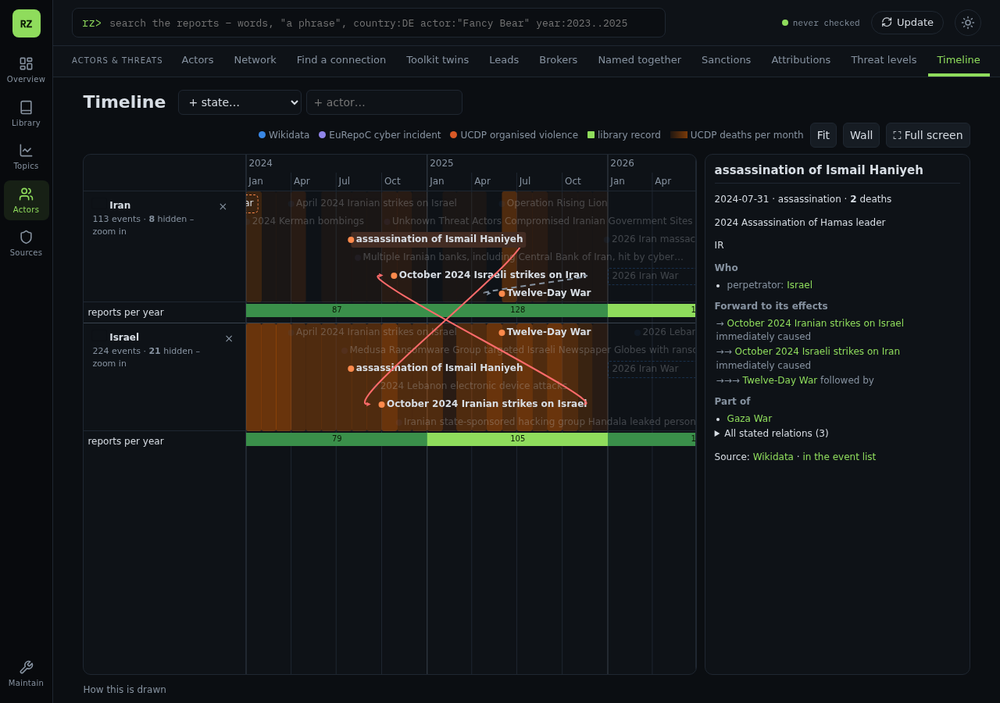

- **Events** (`/events`) – dated events from Wikidata (14 classes, from terrorist attacks and cyberattacks to coups, wars and
  natural disasters, since 2000), EuRepoC's cyber incidents and UCDP's organised violence (single events with at least 50 deaths;
  deaths per country and month), each with its source: date, place, deaths, participants and perpetrators linked to the actor
  index where they match unambiguously, and the relations the Wikidata items state (cause and effect, what followed, what was
  part of what), and the reports that name it – by its Wikidata names in the library's languages, in its year or later, under
  transparent rules shown with every event (96.7 % precision on a random sample); each count opens `/documents?event=…`.
  Actor pages list their events, and the network has an *Events* layer (`fetch-events`, `index-events`).

- **Who cites whom** (`/citations`) – a chord diagram of citations between agency types (each ribbon opens its reports) and the web addresses in the reports resolved against the library: which agencies other
  agencies link to, which library reports are cited by other reports, which outside hosts (news, academic, law …) the reports rely
  on. Report pages list what a report links to and which reports link to it; every count links to the reports it counts.

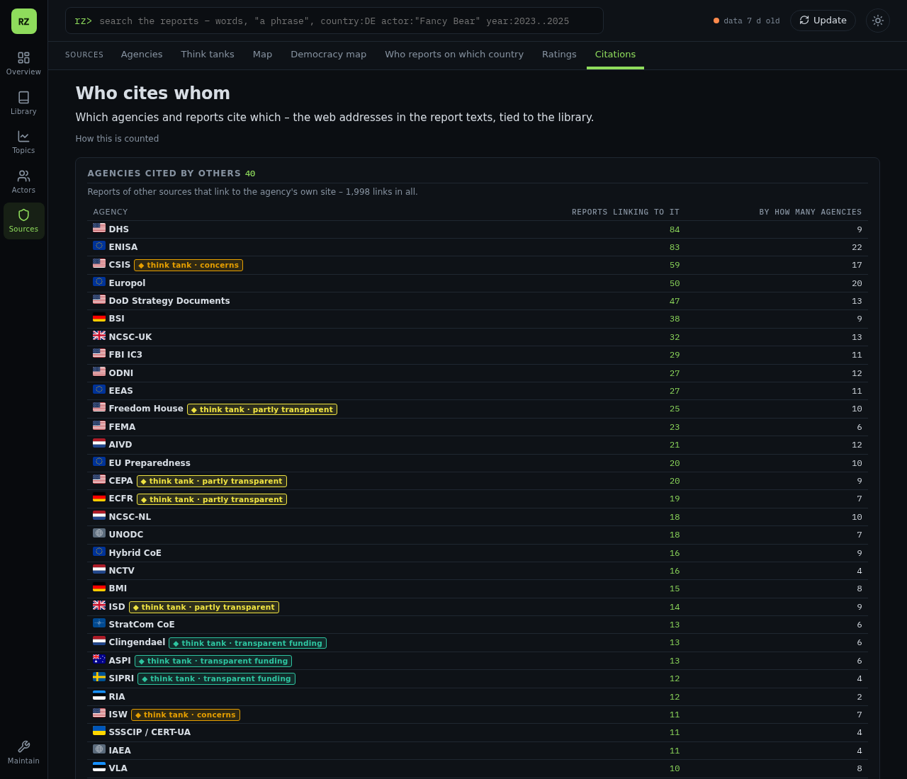

  The **agency × agency matrix** (`/citations#matrix`) sets the 30 most citing agencies against the 30 most cited: each cell
  counts the reports of the row agency that link to the column agency – its site or one of its reports in the library –
  and opens exactly those reports. The shade is the cell's share of the row's citing reports, so it shows what each agency
  relies on rather than who publishes most; think tanks ◆ and commercial analysts ■ are marked, links to an agency's own
  site are left out, and the page says how many pairs and reports fall outside the top 30. *By country* folds the same links
  into country × country, its diagonal being agencies of one state citing each other.

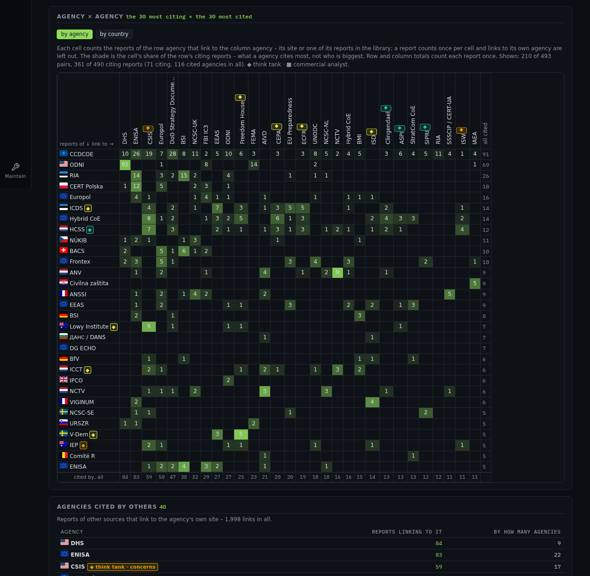

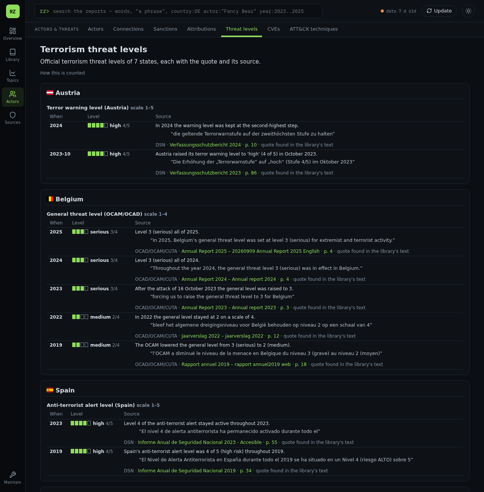

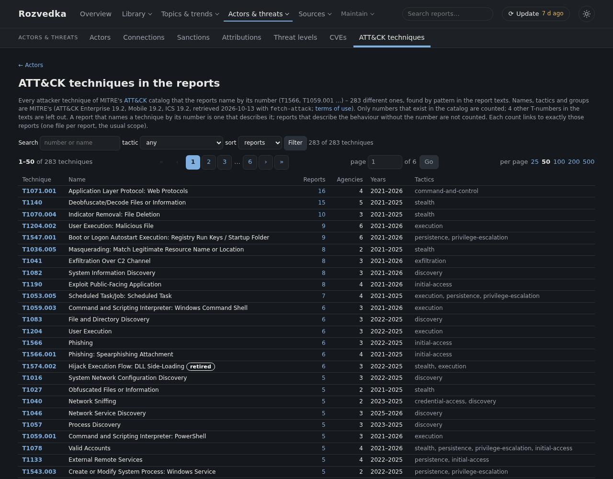

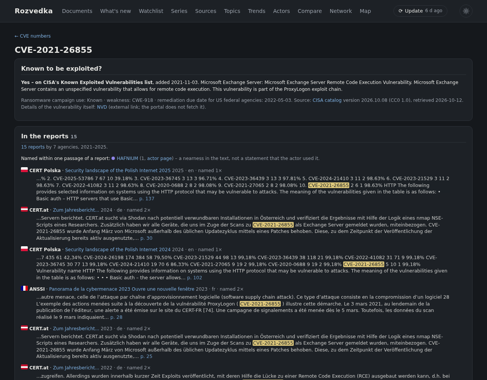

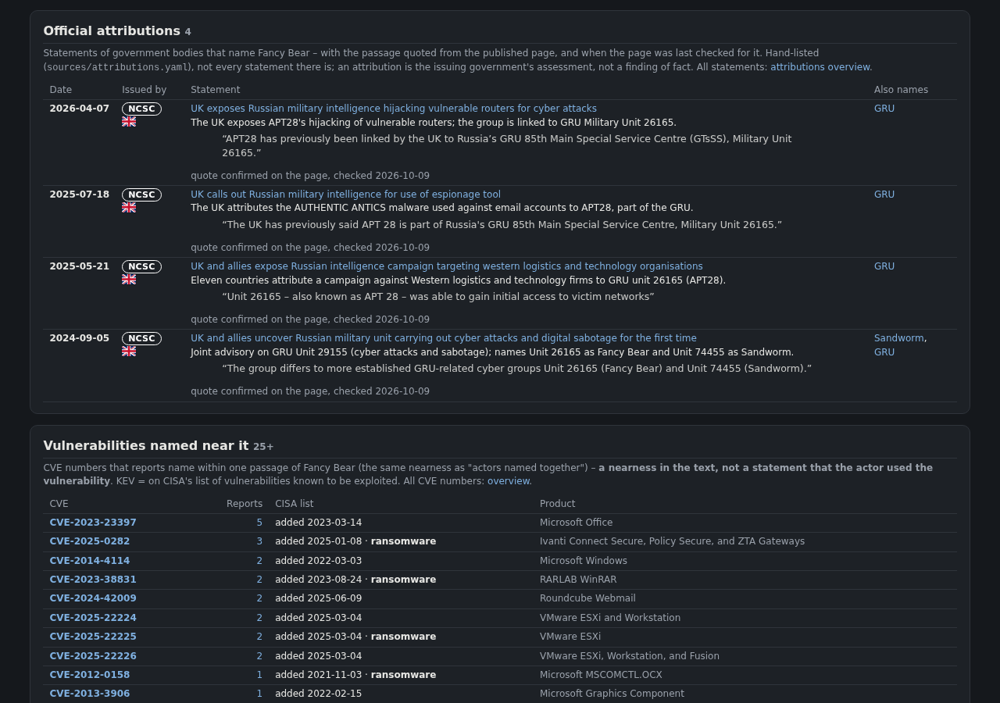

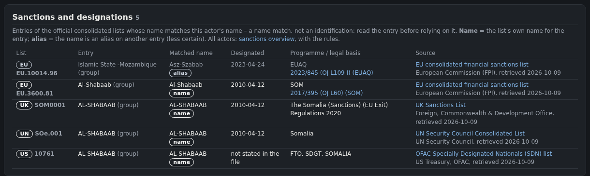

- **Sanctions and designations** – the official consolidated lists of the **EU**, the **UK**, the **UN Security Council** and
  the **US (OFAC SDN)**, fetched with `fetch-sanctions` (public XML files; the portal itself makes no outside calls),
  matched with the actors by name. Each actor page lists its entries with the list, reference, name that matched,
  date, programme and legal basis (EU: the Official Journal text) and the source with its retrieval date; the
  overview (`/actors/sanctions`) filters by list, actor kind and how the name matched. A match is a *name* match, not
  an identification: the rules are stated on the page (one-word names need five letters, people need two words, a name
  two actors share is skipped, weak aliases and bare noms de guerre are not used), and the two tiers – **listed
  under this name** (38 of 40 sampled right) and **only as an alias** (23 of 30) – are shown apart.
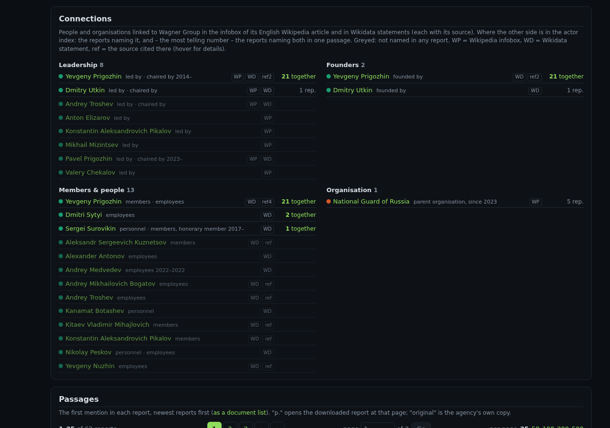

- **Connections** – the people and organisations around each actor: members, leaders, founders, key people,
  parent organisations, subsidiaries and wings, allies, employers, party memberships. They come from the
  infobox of the actor's English Wikipedia article and from Wikidata statements (in both directions), each with
  its source – article, infobox field and revision, or Wikidata statement and cited reference. The connected
  people are added to the index and found by their full names, so a report naming e.g. Alexander Nix shows his
  link to Cambridge Analytica.
- In the reports: every passage lists the actors named nearby and marks those with a known connection
  ("member of the party", "led by" …); pair pages show the documented connection above the passages, and the
  Network marks connected ties with ⛓.
- Beyond security services and armed groups the index covers political parties (AfD, FPÖ, Rassemblement
  National, United Russia, CCP …) and companies, think tanks and media (Cambridge Analytica, Heritage Foundation,
  RT, Huawei, Gazprom …); add more as seeds in `sources/actors.yaml`.
- **Search with suggestions** on the Actors page: type part of any name or alias, in any language and with any
  spelling – *prigozin*, *hezbolah*, *alkaida*, *Лукашенко*, *apt 28* – and up to 12 actors appear with picture, kind,
  report count and the alias that matched. With fewer than ten direct matches, the actors named most often in the
  same passages as the best match fill the list (e.g. Wagner Group and Putin for Prigozhin). ↑ ↓ Enter to open one.

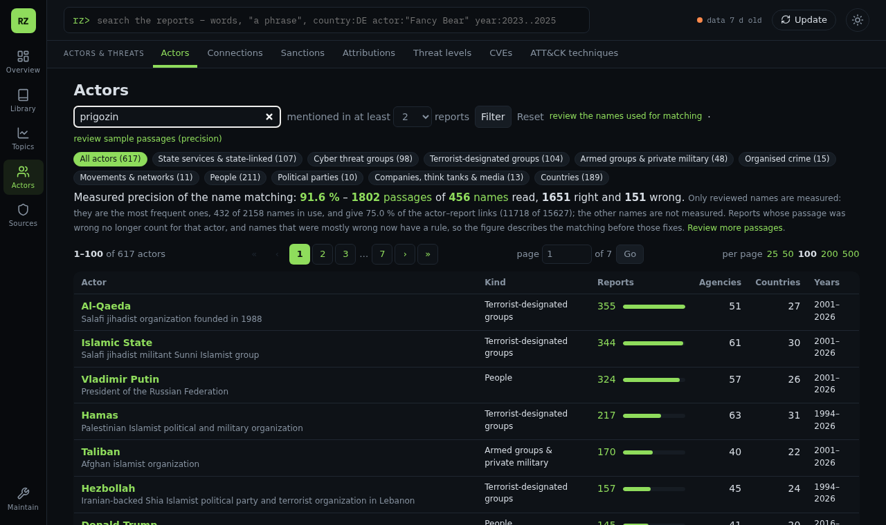

- Name matching is rule-based and transparent: every name used (or not used, with the reason) is listed, and
  `/actors/names` shows the most frequent matches for review.
- **Precision review** (`/actors/review`): random passages of the names that put the most reports on their actor,
  each marked ✓ right or ✗ wrong; any passage on an actor page can also be marked *✗ not …*. A wrong verdict
  removes that report from the actor at once and on every rebuild; every verdict is kept with its passage as
  evidence in [`sources/actor_reviews.yaml`](sources/actor_reviews.yaml), gives each name a measured precision, and
  the actor page lists the reports left out this way.
- **Measured precision on the Actors page**: how many passages were read, how many were right and wrong, and how
  much of the index the reviewed names cover (as of 0.46.1: 91.6 % on 1,802 passages of the 456 most frequent names,
  about 75 % of the actor–report links; the other names are not measured).

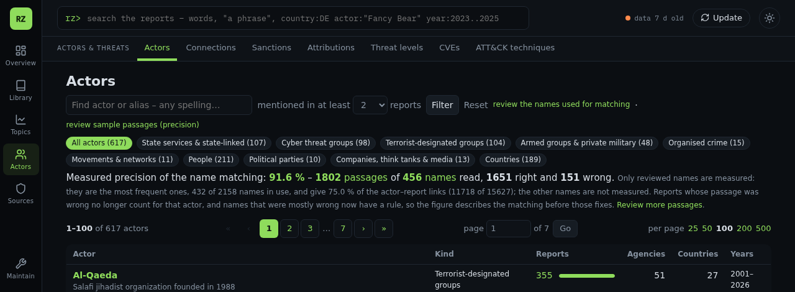

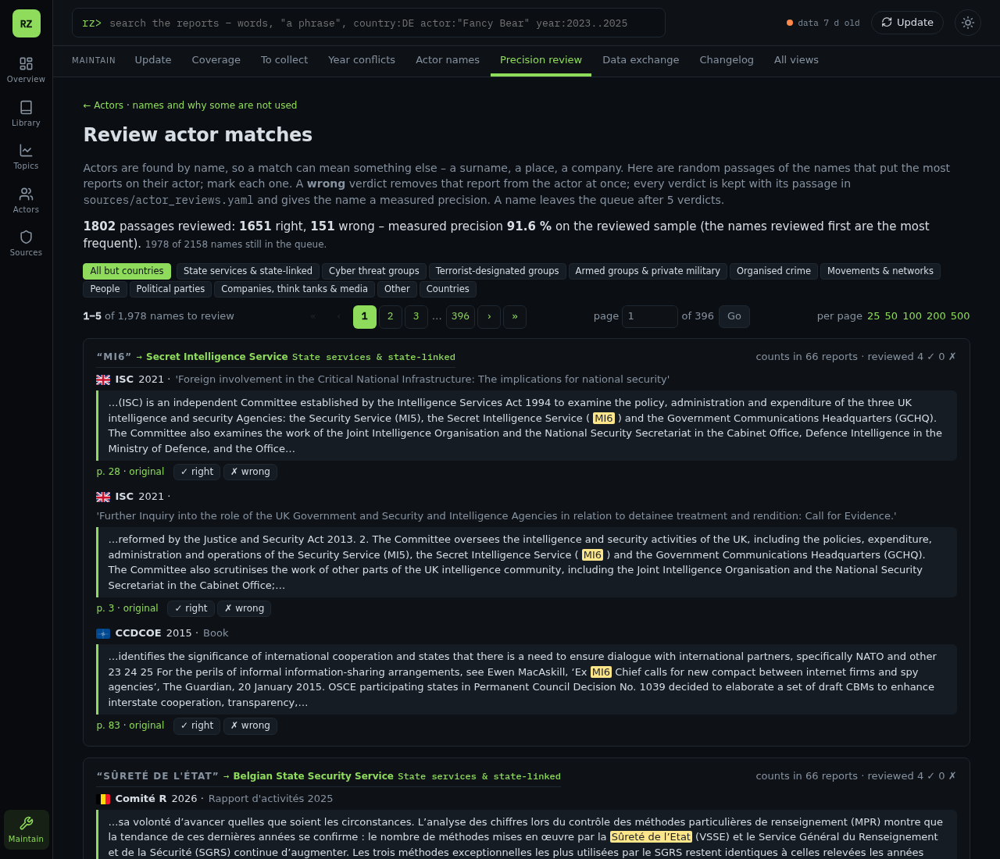

### 🔗 Network – stated links between groups, people, companies and tools

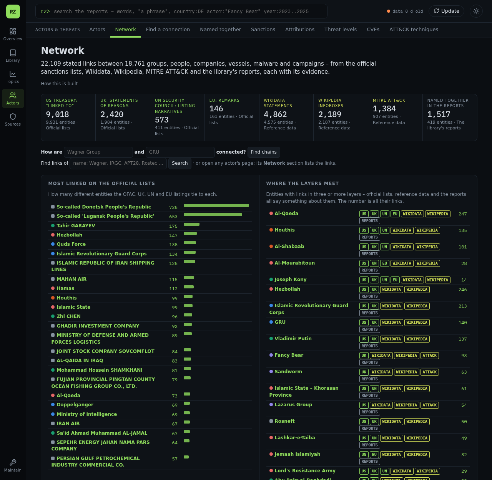

One graph of **39,000 links between 20,700 entities** – groups, people, companies, vessels, aircraft, malware, tools
and campaigns – each link with the layer it comes from and its evidence. Nothing is inferred: every link is something a
source states.

| Layer | What a link means | Evidence kept |
|---|---|---|
| **US Treasury (OFAC)** | an SDN entry's remarks say “Linked To: …” another entry (the name resolved on the same list) | the remark and the entry |
| **UK, UN, EU sanctions lists** | the narrative of a listing (UK statement of reasons, UN comments, EU remarks) names another listing of the same list; UN listings also by reference number (`QDe.004`) | the sentence, the name it was found as |
| **Wikidata, Wikipedia** | statements and infobox fields of the actor gazetteer (leaders, founders, members, parents, allies) | statement or infobox revision, cited source |
| **Wanted notices** | an FBI or Europe's Most Wanted notice about security names an actor, a sanctions-list entry or another wanted person (`fetch-wanted`); a notice about several people links them | the sentence, the notice, the relation word as a hint |
| **Wikipedia article text** | a sentence of an actor's English Wikipedia article links to another known subject's article (`fetch-wikitext`) | the sentence, section, article revision; the relation word as a hint |
| **MITRE ATT&CK** | a group or campaign uses malware or a tool; a campaign is attributed to a group | MITRE's sentence |
| **Reports** | two actors (not countries) named in one passage of at least two reports – a co-mention | the pair page with the passages |

A sanctions entry matched with an actor is that actor, so the layers meet on the actor pages: Hezbollah's **Network**
section lists the 138 entries OFAC links to it and the UK listings whose reasons name it, each with its reference.
Narrative matching is kept honest by rules – full names only, one-word names only for organisations and only where written
as a name (“Rostec”, not “prosperity”), no names made only of generic words (“Ministry of Defence”: whose?). Two samples of
40 such links read by hand were 37 and 38 right; the wrong ones led to these rules.

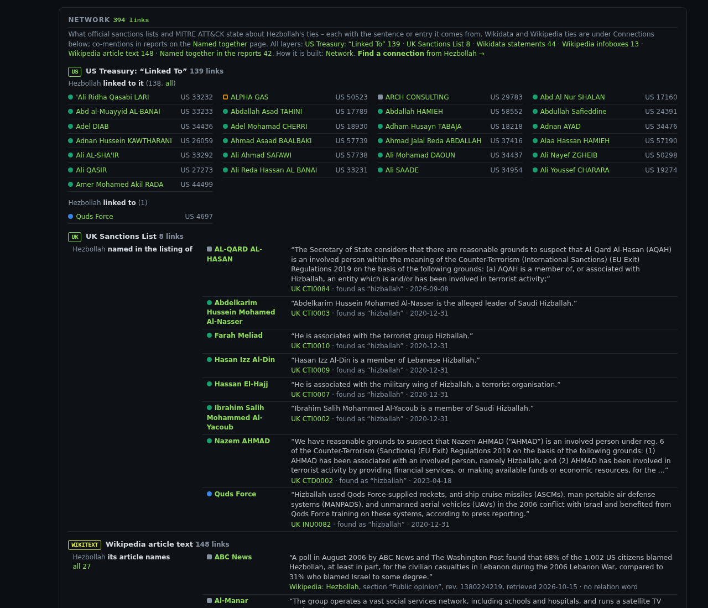

- **Links** (`/graph/ties`): search any name across all layers, filter by layer and kind; every row with its evidence.
- **Entity pages** (`/entity/…`) for what is not an actor: a sanctions entry with its programme and other names, a piece
  of malware, a campaign, a Wikidata person – and its links.
- On the overview: the entities **most linked on the official lists** and those **where the layers meet** (links in three or
  more layers). Every number opens the list of links it counts (checked before each release).

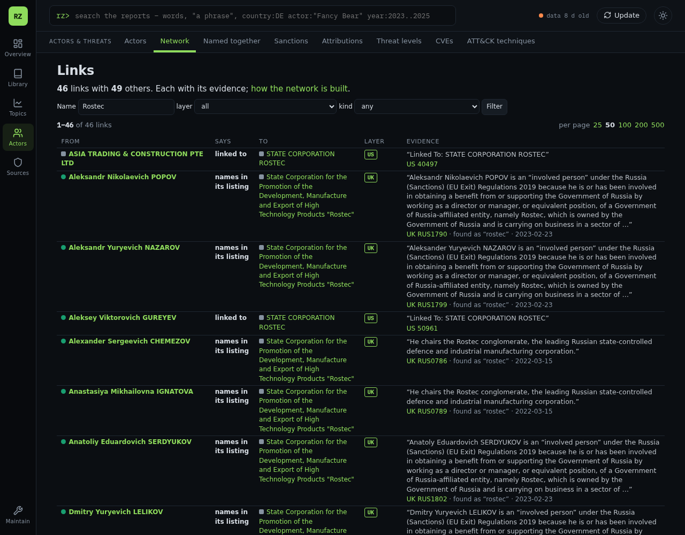

#### One target on several lists, and the details they share

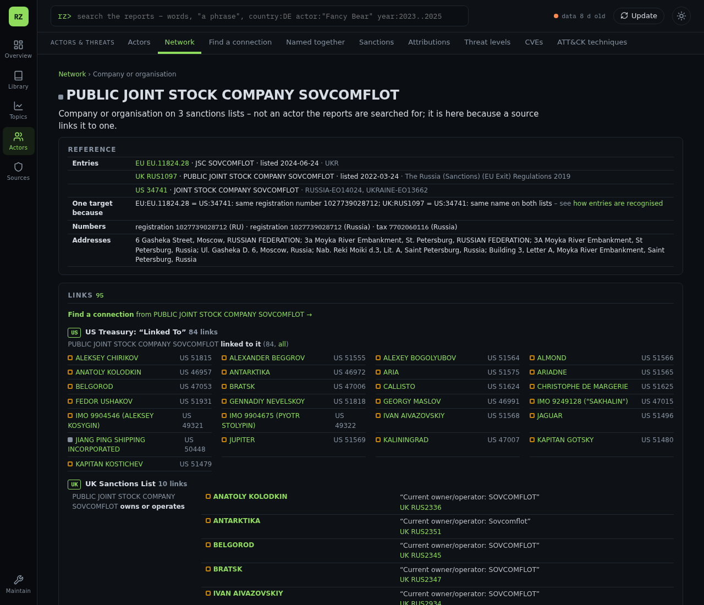

The four sanctions lists describe many of the same targets separately; **11,155 entries are recognised as 4,393 targets**:
when a UK or EU entry gives the UN reference of a UN listing, when entries share an IMO, passport, national ID, company
registration or tax number and a word of their names, or when they have the same name and – for people – the same date of
birth. A target holds at most one entry per list (front companies sharing an alias stay apart), and its page lists the entries
with the reason for each merge, the dates of birth, numbers and addresses. 35 merges read by hand were all right.

**Shared details** become links: a street address, e-mail address, website (on platforms the account, e.g. `vk.com/…`),
telephone number or crypto wallet that two different targets give is an entity linked to both – 2,946 such links. The UK list's
parent companies, subsidiaries and ships' owners and operators are linked by name, legal forms ignored (“PAO Sovcomflot” is the
listed PJSC Sovcomflot).

#### Company ownership (GLEIF)

**Who owns a sanctioned company?** `python -m rozvedka fetch-gleif` downloads the register of legal entity identifiers (GLEIF's
golden copy, CC0, ~500 MB) and keeps it only for the companies on the sanctions lists. A list entry is matched to a GLEIF record:

1. by the **LEI** the entry states (OFAC gives one for 185 entries);
2. by its **register or tax number** in the same country, when the record also shares a distinctive name word (Cyrillic read in
   Latin letters) or the number is a Russian or Belarusian OGRN, since register numbers repeat across countries;
3. by its **name**, in the same country, when the name is distinctive and only one record carries it ("Orion LLC" is not).

Of 16,318 list companies, 565 matched (176 by LEI, 216 by number, 173 by name). In hand-read samples of 40, 39 number matches and 40
name matches were right, including renamed companies found through GLEIF's former names ("2Rivers DMCC" was "Coral Energy DMCC").
Each matched company gets its LEI record on its page (legal name, register number, status, why it is the same company), and its
**parents, branches and consolidated entities** become a network layer: LUKOIL's 24 subsidiaries abroad, VTB's and Sberbank's banks
and funds, Gazprom-Media under Gazprombank. Each link has its GLEIF relationship record with type, status, period and how it was
validated. A company on no list is its own node, marked as a GLEIF record.

#### Offshore leaks (ICIJ) – leaked records, not official

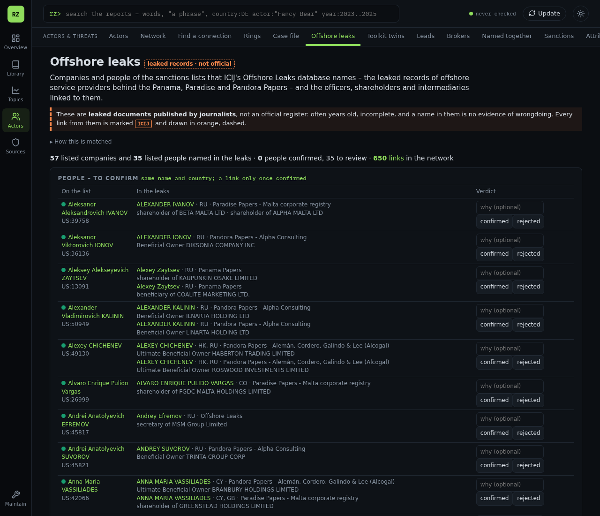

**Which listed companies and people appear in the Panama, Paradise and Pandora Papers?** `python -m rozvedka fetch-icij`
downloads ICIJ's Offshore Leaks Database (ODbL, ~72 MB) and keeps only what concerns the sanctions lists. These are **leaked
documents of offshore service providers published by journalists**, not an official register. They are often years old, and a
name in them is no evidence of wrongdoing. Every link from them is marked `icij`, drawn in orange and dashed, and counted
apart from the official lists.

- **Companies** are matched by the same distinctive name in the same country: 57, for example IRISL's ship-owning companies in
  Malta, the Libyan Investment Authority, Ledra and Vassiliades in Cyprus, and Petropars.
- **People** need a rarer name, but a name and a country are still shared by many people ("Alexander Ivanov", "Muhammad
  Iqbal"), so each person's match waits on `/graph/offshore` until you **confirm** it. The leak record's own links are shown
  to help, and verdicts are kept in `sources/icij_reviews.yaml`. Unconfirmed matches are shown on the person's page but never
  drawn as links.
- One step out: the companies they are officers, shareholders or beneficial owners of, the officers of their companies, and
  their intermediaries. That gives 650 links and 471 leak records as nodes. Addresses and ICIJ's own "same name" guesses are
  left out.

#### Vendors' names and toolkit twins

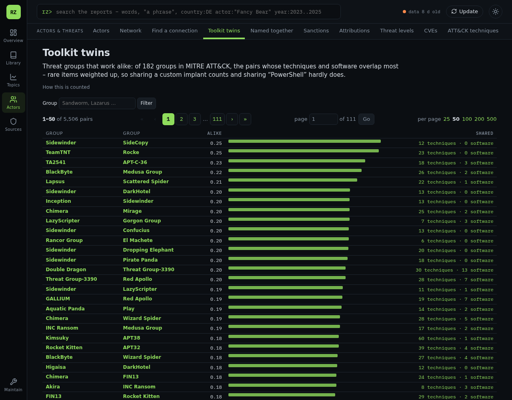

- **One group, many names.** APT28 is *Fancy Bear*, *Forest Blizzard*, *STRONTIUM*, *Sofacy*, *Pawn Storm*, *UAC-0001* … The
  [MISP threat-actor galaxy](https://github.com/MISP/misp-galaxy) (`fetch-misp`) ties 176 of its groups to the gazetteer's actors (by
  the ATT&CK number among their synonyms, else by a name only one actor has) and adds the vendors' names to the report matching –
  with the usual rules, and only names that cannot be ordinary words (a digit as in *TA422*, or an all-capital code name such as
  *STRONTIUM*; not *Pioneer* or *Axiom*) and that are no other actor's own name (MISP lists *APT38* under Lazarus) – 92 report
  matches go through such a name (*Cloud Hopper*, *UAC-0057*, *UNC788*), 15 read by hand all right. MISP's
  statements that two groups are similar or overlap are a network layer of their own.
- **Toolkit twins** (`/graph/twins`): threat groups that work alike – of 182 ATT&CK groups, the pairs whose techniques and software
  overlap most, each item weighted by how rare it is (sharing a custom implant counts, sharing PowerShell hardly does). A pair's
  page lists what the two share, rarest first, what only one uses, and the CVE numbers reports name near both; actor pages show
  their closest twins. Alike is not linked – a lead to read about, kept apart from the stated links.

#### Wikipedia article text

The infobox names leaders and allies; the article text says much more – “its first members were from the Badr Organization”,
“an offshoot of PIJ called as-Sabirin”, “a cooperation deal between the SSG and the KGB of Belarus”. `fetch-wikitext` reads the
English articles of the 843 actors the reports name and keeps every sentence that links to the article of another known actor
or person (redirects included, countries left out, See also / References skipped): **12,735 links**, each reading *“its article
names …”* / *“named in the article of …”* with the sentence, its section and the article revision as evidence. Who is meant is
certain – the sentence links to that article. What the relation is comes from a word within a few words of the link (member,
founded, split, funded, led, allied, attacked …) and is shown only as a hint in brackets – *(membership)*, *(support or
funding)* – because a keyword cannot read a sentence: of 40 such hints read by hand, 25 were right. Sentences without such a
word are kept as plain “named in the article”. Leads do not count article links about conflict or without a relation word.


#### Wanted notices

The sanctions lists name whom a government has designated; wanted notices name whom it has charged – GRU and FSB officers,
ransomware developers, Iranian and Chinese state hackers, terrorists, members of criminal organisations – and their text says
which unit they serve in and who was charged with them. `fetch-wanted` reads the FBI's notices (its public API) and Europe's
Most Wanted, keeping only those about security (cyber, counter-intelligence, terrorism, transnational repression, organised
crime – never victims or missing persons, no photographs or descriptions): **376 notices, 571 links**. A notice is merged with
the same person's sanctions entry when name and full date of birth agree (109, e.g. the GRU officers of Units 26165 and 74455),
so *Find a connection* now runs through the people: IRGC → Mostafa Sadeghi → Silent Librarian, FSB → Maksim Yakubets → Evil
Corp. A notice about several people (“GRU 29155 Cyber Actors”) is a case linking them. The relation – *(member or officer)*,
*(charged together)*, *(family)*, *(victim)* … – is a hint from a word near the name: in a sample of 40, all named the right
subject and 24 of 27 hints were right. A notice states an allegation, not a conviction, and the pages say so. Rewards for
Justice is not read: its robots.txt allows only search engines.


#### Leads and brokers


- **Leads** (`/graph/leads`) are hypotheses, marked as such: pairs of actors that **no report names together and no source links**,
  but that share neighbours in the stated network (every layer except co-mentions) – 613 today. Ranked by Adamic–Adar: a shared
  neighbour counts 1 ÷ log(its links), so sharing a small front company says more than sharing a hub. Hubs (over 200 links), shared
  software (that is Toolkit twins' subject) and links that say two are rivals (a shared enemy is no connection) are not counted.
  Each lead's page lists the shared neighbours, least-linked first, with what the sources state on both sides – and a **review**:
  confirmed, rejected or unclear, with a note, kept in `sources/lead_reviews.yaml`. Many top leads are a lineage the sources
  describe in other words (Jama'at al-Tawhid wal-Jihad → Islamic State); the review is where that is recorded.
- **Brokers** (`/graph/brokers`): entities whose stated links reach actors of several worlds – state services, cyber groups,
  terrorist groups, armed groups, organised crime – ranked by the side they reach less (a broker joins worlds). Each number opens
  exactly those links: e.g. Tren de Aragua (organised crime ↔ terrorist-designated groups), the Axis of Resistance, Hezbollah
  (four kinds).


#### Find a connection


**How are two groups, people, companies or tools connected?** Type two names (suggestions as you type: actors by any of
their names, sanctions entries, malware, campaigns) and get up to five chains of stated links, **the most specific first**:

- A step costs less on an official sanctions list than in reference data, and least of all where two actors are only named
  together in reports; passing *through* an entity costs more the more links it has. A chain through Islamic State or the
  “Donetsk People's Republic” (hundreds of links) says little; one through a single listed person says much – Evil Corp →
  **Maksim Yakubets** → FSB, both steps from the US Treasury's list. Common system tools (net, PowerShell, Mimikatz) cost extra.
- The next chains may not reuse the intermediate entities of the earlier ones: other routes, not variations of one.
- Each step reads as the source states it (“← linked to”), with its layers; steps that rest only on co-mentions are flagged;
  the evidence of every step – the list remark, the sentence, the Wikidata statement, MITRE's text – is one click away.
- Choose the layers (e.g. only the official lists) and whether chains may pass through countries. Where no chain exists,
  the page says whether the two are in separate parts of the network and how large each part is.
- Every actor and entity page links to it (“Find a connection from …”).

#### Rings


**Who is around one entity?** `/graph/rings` puts an actor, a company or a person in the middle. Its stated links are on the
inner ring, the entities two steps away on the outer ring, and every name stays readable:

- **One sector per source.** A neighbour sits in the sector of the strongest source that states its link: official lists
  before reference data before co-mentions. A double line means several sources state it. Choose all stated links, the
  official lists only, reference data only, or everything including co-mentions; countries are left out unless asked for.
- **A choice, said out loud.** Hezbollah has 280 stated links and 262 entities two steps away, so the inner ring draws the 40
  stated by most sources (then actors of the reports, then the most specific). The outer ring draws the 48 linked to the most
  of them, with hubs weighed down as on Find a connection. Each sector says how many it has and how many are not drawn.
- **Every number opens its list.** The tables below the drawing list every neighbour and everything two steps away, with ●
  on what is drawn. Each row has its evidence or chain on Find a connection. Hover a name to see its links.
- Every actor and entity page links to it (“Rings around …”).


**How are the neighbours linked among themselves?** The *Matrix* switch shows the same neighbourhood as a matrix. There is one
row and one column per neighbour (the 60 with most links to the others), and a mark where a source states a link between
two of them. The rows are ordered by **communities** (Louvain modularity), which form blocks on the diagonal. Around
Hezbollah, for example, there is a Quds Force / IRGC block, Hamas and the Gaza war, Hezbollah's own commanders, a jihadist
block, and Maduro with Tren de Aragua and the Zetas. Each mark is coloured by its strongest source and opens its evidence.
The communities, every link in the matrix and the neighbours linked to none of the others are listed below it.
- By default both views use **links that connect**: rivalries ("opposed to") and Wikipedia sentences without a relation word
  are left out, as on Leads and Brokers. The other choices bring them back.

#### Case file


**One board for what you are looking into.** Pin up to 12 entities with **📌 Pin** on an actor, entity, Rings or Find a
connection page, or type a name on `/case`, and add a note to each. The board shows:

- **Steps between them:** a grid with the length of the most specific chain between every pair (1 = a direct link). Each
  number opens all the chains of that pair with their evidence.
- **How each pair is connected:** the chain itself, step by step as the sources state it. Steps that rest only on
  co-mentions in reports are marked.
- **Connectors:** entities that sit on the chains of several pairs, often the thread to pull.
- **Export as Markdown:** the pins and notes, every chain with a citation for each step (list entry, Wikipedia revision,
  Wikidata statement, retrieval date, the quoted sentence), and the connectors.

The case file is kept in `data/case_file.yaml`. It is never committed, and only **personal backups** carry it, because it
says what you are looking into. Chains here, on Find a connection, Rings and Matrix use **links that connect** by default:
rivalries and Wikipedia sentences without a relation word are no sign of a connection.

### 🕸️ Named together


Which actors the reports name **together more often than their frequency predicts** – not just most often:

- **Clusters** of strongly associated actors (e.g. *Wagner Group · Prigozhin · Internet Research Agency*,
  *Fancy Bear · Cozy Bear · Turla · Ghostwriter*, *LockBit · Conti · Akira*), each as a card with its members,
  strongest ties, the main topics of its reports, a timeline and the agencies that report on it.
- **Association matrix** of all actors, ordered by cluster: each cell is a pair named in the same passage, shaded
  by association strength (normalised pointwise mutual information); clusters appear as blocks.
- **Details panel**: an actor's most strongly associated and most frequent partners, or a pair's counts against
  what chance would predict.
- Filter by period, reporting coalition, agency type, topic and kind of actor. Every number opens the passages or
  reports it counts.

### 🗺️ Map

<table>
<tr>
<td width="50%"></td>
<td width="50%"></td>
</tr>
<tr>
<td><b>Headquarters</b> – every agency on a dark world map, coloured by type, with a hover card.</td>
<td><b>Who reports on whom</b> – the share of each country's reports that name a country, or what one country or coalition reports on.</td>
</tr>
<tr>
<td width="50%"></td>
<td width="50%"></td>
</tr>
<tr>
<td><b>Ratings</b> – every country coloured by its regime type, Liberal Democracy Index, its ten-year change, Freedom House
or World Bank score – or by any security or governance measure – in any year since 1990 (slider, ▶ plays the years).</td>
<td>The panel counts states per regime in the world and in the library, and ranks the library's states with a trend
line, the change and the number of reports of that year – each count opens its documents.</td>
</tr>
<tr>
<td width="50%"></td>
<td>Each measure keeps its direction: blue is always the better end (fewer homicides, more stability, less corruption),
orange the worse; military spending, which has no better end, gets a single-hue scale.</td>
</tr>
</table>

Countries are recognised by their names and demonyms in the report languages (from Wikidata); a country's own
reports are left out, and selections with fewer than 10 reports are greyed out.

The Headquarters view can also shade countries by today's regime type, and each agency card shows its state's regime
type (V-Dem, latest year), so a report can be read with its state's record in mind. On the Democracy view the library's
sources are dots sized by their reports (think tanks dashed, in their credibility colour); hovering a country shows all
measures of that year with a trend line, and every colour and count names its source and retrieval date.

### 🧠 Topic mind map


Categories → topics → the actors most characteristic of each topic (counted in the reports that have the topic
among their three main topics), with a details panel and links to every count. Click a category or topic to unfold or
fold it, or use **Expand all**, **Topics** (the default) and **Collapse all**; each column is as wide as its longest
label and long names wrap, so labels never overlap. A filled dot has folded branches; dot size shows the reports.

### 💾 Data exchange – backup and sharing without crawling

*Sources → Data exchange* (`/data`) backs up the whole library or hands it to someone else, who then does not have
to crawl the agencies – and either side can crawl on from there.


- **Export** in three steps: *what* – everything, the catalogue only (the receiver downloads the report files from
  the agencies), or the catalogue plus the report files added since a day – each with its size; *where* – a folder
  picker over USB disks (`/media`, `/mnt`) and the home folder, with free space and *new folder*; *options* – the
  largest file (4 GB … 100 MB, 2 GB fits most transfer services) and a label. A meter shows whether it fits.
- **Personal backup or a dataset to share**: tick *Personal backup* to include the data this library keeps for
  personal use only: the book library (files, text and what the books say) and RSF's press-freedom scores. The
  page lists what this library holds of it. Such a dataset's file names end in `-personal`; the import list marks it
  *personal backup*, and the import report says what it holds. Leave the box off for a dataset to hand on: it then
  carries the country ratings without RSF and no books.
- The result is a **dataset**: one tar stream cut into files of at most that size plus a manifest – who made it,
  when, with which version, how fresh the data is per source, the SHA-256 of every file. Inside: a consistent copy of
  the database, the report files, logos, the actor gazetteer, the country ratings and the lists the portal keeps.
- **Import**: pick the folder with the dataset's files; datasets found there are listed with their date, origin,
  size and whether all files are present. **Check and compare** verifies every file and compares the dataset with
  the library – newer, older, mixed or complementing (same crawl state, but reports this library lacks), per source
  and per report – without changing anything; then **Import**, choosing whose hand edits win in a conflict.
  An **empty installation** is restored from the dataset; an **existing library** is merged – sources, pages and
  reports matched by key and address (ids differ between installations), missing reports, files, text and OCR
  added, empty years filled, the later crawl dates kept, conflicting hand edits listed. Reports whose file the
  dataset does not carry are marked for download; an older dataset adds nothing; importing twice changes nothing.
  Country ratings are taken measure by measure when the dataset's are more recent; a personal backup's books come
  with their record and what they say.
- **Progress** for every step (copying and compressing the database, writing, checking, merging, writing files,
  matching topics and actors), with a progress bar, size, speed and time left, the live **log** (kept in
  `data/logs/`), and **Cancel** – an export removes its partial files; an import can be stopped until it starts
  changing the library. Before any change the database is copied to `data/backups/` (the last three are kept).
- The same on the command line: `python -m rozvedka export DIR` / `import DIR [--check]` (see Commands).
- On this Raspberry Pi the full library (3,442 reports, 14.9 GB in 8 files) exports in about 18 minutes and restores
  into a new installation in about 27; checking alone takes about 6. The catalogue only takes about 2 minutes (280 MB).


### 🌗 Dark and light theme

Dark by default; the sun/moon button in the header switches to light and back. The choice is remembered in the
browser, and charts redraw in the matching colours. The maps stay dark in both themes.

### ⟳ Update – check the agencies for new reports

Rozvedka looks for new reports only when you start it – there is no schedule. The **⟳ Update** button in the header
of every page shows how old the data is (every source checked since …; amber after a week) and, while an update
runs, its progress; it opens the **Update** page (`/update`):


- **What to do** – a *full update* (check the report pages, download the new reports, improve titles, extract text,
  OCR, dates, topics and actors), *check only* (list new reports without downloading them), or *download the
  waiting reports* (optionally retrying failed ones).
- **Which sources** – all, those not checked for N days, one country, or the ones ticked in the table; the page says
  how many report pages that is and about how long it takes (measured on earlier runs).
- **Progress** – the steps, a bar with the source being checked or the downloads done, time left, the live log (kept in
  `data/logs/`) and the result: new reports per source, with links to *What's new* and the reports added that day.
  **Cancel** stops between pages or downloads; what was found and downloaded so far is kept.
- **Sources** – every source with its report pages' last check, the outcome (fine, error, blocked by robots.txt,
  skipped, collected by hand – each page's status on a click), its reports, the new ones the last check found and those
  waiting for download; filter by outcome, country or name; *Check now* on one source.
- **History** of the checks and downloads, with how long each took.

Crawling is polite: robots.txt is respected and each host gets at most one request every 2 seconds. Long jobs run one
at a time (an update, an export or an import); the indexers run as separate processes.

## Quick start

```bash
git clone https://github.com/iiogurt/Rozvedka.git      # any folder; nothing depends on where it lives
cd Rozvedka
python3 -m venv .venv && .venv/bin/pip install -r requirements.txt
sudo apt install poppler-utils firefox       # pdftotext (text extraction), Firefox (JavaScript-only sites; firefox-esr on Debian)
sudo apt install ocrmypdf tesseract-ocr tesseract-ocr-eng tesseract-ocr-spa …   # optional: OCR for scanned reports

.venv/bin/python -m rozvedka update          # crawl, download, extract and index (first run: hours)
.venv/bin/python -m rozvedka fetch-actors    # reference data for the actor index (a few minutes)
.venv/bin/python -m rozvedka index-actors
.venv/bin/python -m rozvedka serve           # → http://127.0.0.1:8080 (this computer only)
.venv/bin/python -m rozvedka serve --host 0.0.0.0   # → http://<this machine's address>:8080 for the home network
```

> [!WARNING]
> The portal has no login. By default it answers only on this computer; with `--host 0.0.0.0` everyone on the
> network can use it – start updates, imports and exports. Do that only on a trusted home network, and never forward
> its port to the internet. See [Security](#security).

> [!NOTE]
> `data/` is not in git. It holds the database (`rozvedka.db`), the downloaded PDFs (`files/`, 14+ GB), logos and
> the actor gazetteer. Back it up as a dataset (*Sources → Data exchange*).

### Starting the portal

The portal runs when it is started – it is not set up to start by itself after a reboot, and nothing runs on a
schedule (both the owner's decisions; updates are started on the *Update* page):

```bash
cd Rozvedka                                   # the project folder
nohup .venv/bin/python -m rozvedka serve --host 0.0.0.0 > data/logs/portal.log 2>&1 &
```

**Optional: run the portal as a systemd user service.** Off by default and never started by the project; for whoever wants
the portal restarted if it stops, and started at login:

```bash
.venv/bin/python -m rozvedka service show        # the finished unit, nothing written
.venv/bin/python -m rozvedka service install     # writes ~/.config/systemd/user/rozvedka-web.service, reloads systemd
systemctl --user start rozvedka-web              # your decision: start it …
systemctl --user enable rozvedka-web             # … and/or start it at every login
```

`install` never enables or starts the service (`--host 127.0.0.1` keeps it to this computer, `--port` changes the port);
`service status`, `service verify` (systemd-analyze) and `service uninstall` (refuses while it runs) complete the set. The unit is sandboxed
(`ProtectSystem=strict`; it may write only in the project folder, the data folder and removable media) and restarts on
failure. Starting it after a reboot with nobody logged in needs `loginctl enable-linger <user>` (sudo) – not part of the project's setup.

## Commands

`python -m rozvedka <command>` (from the project directory, with `.venv/bin/python`):

| Command | What it does |
|---|---|
| `update [--country CZ]` | crawl → download → improve titles → index topics → OCR → dates → actors (the *Update* page does the same with progress; runs only when started) |
| `sync-registry` | load `sources/registry.yaml` into the database |
| `crawl [--country CZ] [--agency BIS]` | find new documents on the report pages (no download) |
| `download [--country CZ] [--limit N] [--retry-failed]` | download discovered documents |
| `index-topics [--reextract]` | extract text for full-text search and tag topics; re-classifies after `topics.yaml` changes |
| `ocr [--limit N] [--workers 3]` | recognise the text of scanned reports (no text layer) with Tesseract via OCRmyPDF, in the report's language + English; stores the text with page breaks, marks it as OCR, leaves the PDF unchanged (part of `update` when installed) |
| `date-documents [--check]` | give undated reports a year from their first pages – a report heading, else a publication date – with the evidence; `--check` measures accuracy on reports whose year is known (part of `update`) |
| `fetch-actors [--refresh]` | download the actor gazetteer and connections from Wikidata, Wikipedia and MITRE ATT&CK (network; Wikipedia infoboxes are cached in `data/gazetteer/` – `--refresh` reads them again) |
| `service show\|install\|status\|verify\|uninstall` | the optional systemd user service for the portal (see Quick start): `install` only writes the unit file, it never enables or starts it |
| `index-citations` | resolve the web addresses in the report texts: other library reports, other agencies' sites, outside hosts (`update` runs it) |
| `fetch-threat-levels` | check the official threat-level announcements in `sources/threat_levels.yaml` against their pages (network); the reports' quotes are checked against the library when the page is shown |
| `fetch-kev` · `index-cves` | download CISA's Known Exploited Vulnerabilities catalog (CC0; network) · find CVE numbers in the report texts and the actors named near them (`update` runs the second) |
| `fetch-attack` · `index-techniques` | download MITRE ATT&CK (techniques, groups, software, campaigns and their relations; Enterprise, Mobile, ICS; network) · find technique numbers in the report texts (`update` runs the second) |
| `fetch-wanted` | read the FBI's and Europe's Most Wanted notices about security (network, ~3 min; then `build-graph`) |
| `import-books [FOLDER] [--no-lookup] [--no-index]` | read the PDFs and EPUBs of the local book library (`data/books/`) into the library: metadata from `books.yaml`, Open Library by ISBN or the file; text, topics and actors like a report; never counted as reports, never exported |
| `index-books` | chapters, printed page numbers and the book's own index for every book of the local library (no download) |
| `index-events` | find the reports that name each event (its Wikidata names, in its year or later; no download – `fetch-events` runs it too) |
| `fetch-events [--source wikidata\|eurepoc\|ucdp]` | dated events for the timeline: Wikidata items of the classes in `sources/events.yaml`, EuRepoC cyber incidents, UCDP organised violence (network, ~10 min) |
| `fetch-wikitext` | read the English Wikipedia articles of the actors the reports name and keep the sentences that link to another known subject (network, ~5 min; then `build-graph`) |
| `fetch-icij` | download ICIJ's Offshore Leaks Database (ODbL, ~72 MB) and keep the listed companies and people it names, one step out (network, marked as leaked records; then `build-graph`) |
| `fetch-gleif` | download GLEIF's register of legal entity identifiers (CC0, ~500 MB, ~15 min) and keep the sanctioned companies' records, parents and branches (network; then `build-graph`) |
| `fetch-misp` | download the MISP threat-actor galaxy (CC0): security vendors' names of threat groups and which groups it holds similar (network; then `index-actors` and `build-graph`) |
| `build-graph` | rebuild the network of links from what is stored: sanctions lists, Wikidata and Wikipedia connections, ATT&CK, the actor index (no network; `update` runs it last) |
| `fetch-attributions` | check the official attribution statements in `sources/attributions.yaml` against their pages (network); the result with the check date is stored in `data/gazetteer/attributions.json` |
| `fetch-sanctions` | download the EU, UK, UN Security Council and US (OFAC) consolidated sanctions lists into `data/sanctions/` and match them with the actors (network; `match-sanctions` matches again without downloading, `index-actors` does it too) |
| `fetch-actor-profiles [--refresh]` | pictures (flag, logo or photo, with author and licence), key facts and Wikipedia leads of every actor the reports name, from Wikipedia, Wikidata and Wikimedia Commons (network; part of `fetch-actors`; `--refresh` downloads the pictures again) |
| `index-actors [--rematch]` | find the actors in the report texts (offline) |
| `fetch-logos [--refresh]` | download agency logos from their home pages |
| `improve-titles` | replace poor document titles with the title stored in the PDF |
| `export DIR [--no-files] [--since DATE] [--part-size 2G] [--name LABEL] [--personal]` | write the whole library as a dataset – parts of at most 2 GB plus a manifest – to hand to someone else, or with `--personal` as a backup for yourself that also holds the data for personal use only (books, RSF scores) |
| `import PATH [--check] [--prefer local\|dataset] [--no-index]` | verify a dataset, compare it with the library (newer / older / mixed / complementing), then restore it into an empty library or merge it into this one |
| `serve [--host] [--port]` | run the portal (default `127.0.0.1:8080` – this computer only; `--host 0.0.0.0` for the home network) |
| `stats` | documents found and downloaded per country |
| `--version` | release version and git build |

Tools in `tools/`: `check_registry.py` (does every registry URL still load), `build_sources_md.py` (regenerate
[`sources/sources.md`](sources/sources.md)), `geocode_hq.py`, `find_variants.py`, `build_events.py` (resolve event
markers against Wikidata), `bump_version.py` (cut a release).

## Configuration

Everything that defines *what* Rozvedka collects and recognises is a hand-editable YAML file in `sources/`:

| File | Contents |
|---|---|
| [`registry.yaml`](sources/registry.yaml) | the agencies: names, type, home page, description, headquarters, report pages (language, current/archive), how to fetch them |
| [`countries.yaml`](sources/countries.yaml) | country names, regions, coalition memberships with year joined |
| [`topics.yaml`](sources/topics.yaml) | topic taxonomy: categories → topics → keywords per language |
| [`actors.yaml`](sources/actors.yaml) | which Wikidata classes, hand-listed seeds and countries make up the actor index, and matching corrections |
| [`series.yaml`](sources/series.yaml) | confirmed report series per source (title stems per language, editions per year, editions confirmed as not published) – written by the portal, editable by hand |
| [`events.yaml`](sources/events.yaml) | reference events for the trend charts (Wikipedia titles; dates are resolved from Wikidata) |

Settings of an installation are environment variables (none is required):

| Variable | Default | Meaning |
|---|---|---|
| `ROZVEDKA_HOST` | `127.0.0.1` | address `serve` listens on – `0.0.0.0` for the home network (same as `--host`) |
| `ROZVEDKA_PORT` | `8080` | port of `serve` (same as `--port`) |
| `ROZVEDKA_ALLOWED_HOSTS` | – | extra host names the portal answers to, comma-separated (IP addresses, `localhost`, `*.local`, `*.lan` and the machine's own name always work) |
| `ROZVEDKA_DATA` | `data/` in the project folder | where the database, report files, logos and gazetteer live |
| `ROZVEDKA_DB` | `$ROZVEDKA_DATA/rozvedka.db` | another database file |
| `ROZVEDKA_EXCHANGE_DIRS` | – | more folders the Data exchange folder picker may use, separated by `:` |

<details>
<summary><b>How sources are fetched</b> (<code>access</code> in the registry)</summary>

| `access` | Behaviour |
|---|---|
| `auto` | plain HTTP fetch |
| `browser-ua` | same, with a curl fallback for servers that reject Python's TLS handshake |
| `tls-lenient` | skip certificate verification (server sends an incomplete chain) |
| `browser-js` | the page is rendered with headless Firefox (Chromium where Firefox is not installed) |
| `manual` | bot-protected; add documents in the portal (Sources → *Add a document by URL*) |

Pages that turn out to be empty JavaScript shells are rendered with the headless browser automatically. Report pages marked
`verified: false` are listed but not crawled.

</details>

<details>
<summary><b>Where the year of a report comes from</b></summary>

- From the title or the address of the file when they contain one (most reports).
- Otherwise (`date-documents`), in this order, each with its evidence stored with the report (hover the year):
  1. a Japanese era year in the title (平成29年版 = 2017), a year in a file name passed in the address
     (`…?file=…Spring-2026.pdf`), or a date stamp in the file name (`20260611_report.pdf`, a publication date);
  2. a **report heading** on the first pages – "Annual Report 2023", "Jahresbericht 2022", "za rok 2021",
     "2023年版" (the covered year; a range gives its end year; the cover page counts first);
  3. **the same folder**: at least three other dated reports in the same folder of the site, all from one year –
     unless the report's first page names another year;
  4. a **publication date** – "12 February 2022", "2024. gada 18. jūlijā", "Utgitt av DSB 2025", "© 2024", with
     month names in the library's languages – shown as *≈ 2024* on the Documents page;
  5. the **only year on a title page** (a first page of under 800 characters).

  A blind check on the ~2,400 reports whose year comes from their title (`date-documents --check`): headings 81 %
  exact / 89 % within one year, same folder 100 % / 100 %, publication dates 66 % / 83 %, lone cover year 82 % / 86 %.
  File-name date stamps disagree with those reference years more often, but where checked by hand the stamp was
  right and the reference year wrong (e.g. UK ISC press releases). PDF creation dates were tested and are not used.
- Years set by hand are marked as such and never changed; no year is ever overwritten.

</details>

<details>
<summary><b>How topics are assigned</b></summary>

- Keyword syntax: `word` (whole word), `stem*` (words starting with the stem), `two words` (a phrase; each token may
  end in `*`), Japanese/Chinese/Korean terms as substrings. Case and accents are ignored; every language's terms
  apply to every document – except in an English text (recognised by its English function words, not by its tag), where
  a single word of another language that reads as a different English word is left out: Latvian `ķīn*` ("China")
  would read "kingdom", Czech `munic*` ("ammunition") "municipal", Spanish `temporal*` ("storm") "temporal". Cognates
  that share their stem with the topic's English terms (`militar*` ~ military) and acronyms in capitals still count.
- A topic is assigned when the title matches, or when at least 2 different keywords occur and the hits keep up with
  the length (≥ 3, and at least one per 15,000 words).
- Text is extracted from the first 150 pages (up to 400,000 characters; a book of the local library whole). After editing `topics.yaml`, run
  `index-topics` again – documents are re-classified from the stored text.

</details>

<details>
<summary><b>How actors are recognised</b></summary>

- **Who is listed:** Wikidata items of the classes in `actors.yaml` (with an English Wikipedia article, not
  dissolved before 2000, no states or companies), items "designated as terrorist by" (P3461), MITRE ATT&CK
  groups (joined to Wikidata through P9025 or a unique shared name), and hand-listed seeds.
- **How mentions are found:** by name – Wikidata labels and aliases in the report languages, ATT&CK aliases,
  hand-added names; case-sensitive, accent-insensitive, headings in capitals included.
- **Rules against false matches** (each shown with its reason on the actor page): ignore lists and per-actor
  exclusions; lowercase, very short and generic one-word names; names shared by several actors; one-word names of
  people other than the surname; generic names and short abbreviations ("FSB", "National Security Council") count
  only together with another name of the actor; the longest of overlapping names wins; reports dated before an
  actor was founded and reports of sources excluded for an actor are not counted.
- **Countries** are actors too (kind *country*): sovereign states from Wikidata with their labels, aliases and
  demonyms ("Russian", "russe"), so the portal can count which countries' reports name which countries. Two-letter
  forms ("UK", "US") count only together with another name.
- **Connections:** Wikipedia infobox fields (leader, founder, key people, parent, subsidiaries, wings, allies,
  opponents, owner; for people: party, branch, unit, employer, organisation) and Wikidata properties (member of
  P463, party P102, employer P108, affiliation P1416, military branch P241, parent P749, part of P361, owned by
  P127, founded by P112, chair P488, director P1037, CEO P169, board P3320). Only links to people and
  organisations are kept; incoming Wikidata links are ranked by notability (Wikipedia language versions) and the
  25 most notable per relation are kept, with the total. Connected people are matched by full name only.
- **Named together:** two actors named within 600 characters in a report are stored as a pair; the network, the
  actor pages and the passage pages (`/actors/<a>/with/<b>`) all count these pairs per report.
- **Correcting it:** `/actors/names` lists the names with the most matches. Add a wrong one under
  `ignore_aliases`, `exclude_aliases`, `weak_aliases` or `exclude_sources` in `actors.yaml` and run
  `index-actors` again.

</details>

<details>
<summary><b>Map data</b></summary>

Headquarters are the publicly listed headquarters or contact addresses (`hq: {address, lat, lon, precision}` in the
registry), geocoded once with OpenStreetMap Nominatim; the portal makes no geocoding calls. Solid pins are exact
buildings, hollow pins street or city level. `/map#s-<id>` zooms to one agency, `/map?tiles=0` works offline.

</details>

## How it works


| Module | Role |
|---|---|
| `rozvedka/registry.py`, `crawler.py`, `fetch.py` | load the registry, find document links (robots.txt, per-host delay, curl fallback, headless Firefox / Chromium for JavaScript-built pages) |
| `rozvedka/downloader.py` | download, check the PDF header, de-duplicate by SHA-256, improve titles |
| `rozvedka/topics.py` | text extraction with page offsets, FTS5 index, topic classification (all CPU cores) |
| `rozvedka/actor_sources.py`, `actors.py` | build the gazetteer from public reference data; match actors in the texts |
| `rozvedka/gaps.py` | the coverage grid: states × agency types, covered, without reports, checked (`sources/coverage_gaps.yaml`) or open |
| `rozvedka/briefings.py` | briefing pages: one topic or one country – reports by year, countries, agencies, emphasised actors and topics (lift × reports), who reports about it |
| `rozvedka/trends.py` | the statistics behind the Trends pages, each with the link that reproduces it |
| `rozvedka/wanted.py` | wanted notices of the FBI and Europe's Most Wanted: fetching, the security filter, entries for the identity rules, relation words |
| `rozvedka/wikitext.py` | links stated in the text of Wikipedia articles: sentences with links, the relation word, redirects |
| `rozvedka/leads.py` | leads (shared neighbours, never named together; reviews in `sources/lead_reviews.yaml`) and brokers |
| `rozvedka/icij.py` | ICIJ Offshore Leaks: listed companies and people matched by name and country, people only once confirmed (`sources/icij_reviews.yaml`), one step out |
| `rozvedka/gleif.py` | GLEIF: the golden copy read as a stream, list companies matched by LEI, number or name, one step of ownership |
| `rozvedka/identity.py`, `vendors.py`, `twins.py` | one target across sanctions lists and the details they share; vendors' names of threat groups (MISP); toolkit twins |
| `rozvedka/rings.py` | Rings and the neighbourhood matrix: an entity's links on two rings, one sector per layer; its neighbours as a matrix ordered by Louvain communities |
| `rozvedka/casefile.py` | the case file: pins with notes in `data/case_file.yaml`, the chain of every pair, connectors, the Markdown export with citations |
| `rozvedka/paths.py` | Find a connection: the most specific chains between two entities (hub-penalised shortest paths, alternatives on other routes), name resolution |
| `rozvedka/ties.py` | the network of stated links: entities and links from the sanctions lists, Wikidata, Wikipedia, ATT&CK and the reports, each with its evidence |
| `rozvedka/graphs.py` | network associations and clusters, who-reports-on-whom and topic mind map data, with the same links |
| `rozvedka/updater.py` | the Update page: plan (pages, duration), the update steps, every source's last check, history |
| `rozvedka/jobs.py`, `progress.py`, `folders.py` | long jobs from the portal (update, export, import): progress, log, cancel, one at a time; the Data exchange folder picker |
| `rozvedka/dataset.py` | datasets: export in parts with a manifest, verify, compare (newer / older), restore or merge |
| `rozvedka/review.py` | precision review of actor matches: the queue, verdicts with evidence, measured precision |
| `rozvedka/watch.py`, `doclist.py` | the watchlist (queries counted update by update); the Documents list's filters as SQL, shared by every count |
| `rozvedka/compare.py` | Compare agencies: per-agency counts and densest passages on one actor or topic |
| `rozvedka/updates.py` | What's new by update and the Atom feed, each count with its link |
| `rozvedka/home.py` | the home page: search-console operators and suggestions, dashboard counts with their links |
| `rozvedka/report.py` | the report page: provenance, series edition and changes, topics with terms, actors with passages |
| `rozvedka/doctypes.py`, `works.py`, `dating.py`, `languages.py` | document types; language versions and summaries grouped into one report; years from the text (or from the report's other language versions) and year conflicts; stored languages checked against the text's script and function words |
| `rozvedka/concepts.py` | cross-language search: concept names in every language from Wikidata |
| `rozvedka/ratings.py`, `publishers.py` | democracy, security and governance ratings of states over time; credibility checks of think tanks and commercial analysts (funding or ownership, EU register, FARA, USAspending, sanctions lists) and their owners and sponsors |
| `rozvedka/app.py`, `web.py`, `routes/`, `templates/`, `static/` | the server-rendered portal: the app and its middleware, what the pages share (templates, helpers, request guard), one route module per area (actors, documents, trends, maps, data, update, …) |

## Database

Everything the portal shows comes from one **SQLite** database, `data/rozvedka.db` (about 600 MB; write-ahead log,
full-text index FTS5). It is a **working copy, not the source of truth**: the hand-written lists in `sources/*.yaml`
(registry, topics, actors, series, think-tank profiles, reviews) and the downloaded files rebuild it – except the edits
made in the portal (a corrected title, language or year, a hidden file, an upload), which live only here and travel in
datasets. Reference data fetched from outside is kept beside it as JSON with its source and date
(`data/gazetteer/*.json` – actors, concepts, think-tank checks; `data/ratings/ratings.json` – ratings of states).

<details>
<summary><b>How to look at the data</b> – read-only, also while the portal runs</summary>

Open the file **read-only** (the portal keeps writing to it; never change it by hand while the portal runs – use the
portal or the commands):

```bash
# the SQLite shell (sudo apt install sqlite3)
sqlite3 -readonly data/rozvedka.db
sqlite> .tables
sqlite> SELECT s.agency, COUNT(*) FROM documents d JOIN sources s ON s.id = d.source_id
   ...> WHERE d.hidden = 0 GROUP BY s.agency ORDER BY 2 DESC LIMIT 10;

# or Python, without installing anything
.venv/bin/python -c "import sqlite3; c = sqlite3.connect('file:data/rozvedka.db?mode=ro', uri=True); \
  print(c.execute('SELECT COUNT(*) FROM documents').fetchone())"
```

On a desktop, **DB Browser for SQLite** (open read-only) or **Datasette** (`datasette data/rozvedka.db`, a browsable web
view – keep it on your LAN like the portal) work well. To look at the data on another computer, export a *catalogue
only* dataset on *Data exchange* (about 250 MB) and take the database out of it:
`cat rozvedka-dataset-*.tar.* | tar x --occurrence=1 db/rozvedka.db.gz && gunzip db/rozvedka.db.gz` (a few seconds;
the database is the first member).

A few useful queries:

```sql
-- full text: reports whose text mentions "drone" or "Drohne" (FTS5; doc_text.rowid = documents.id)
SELECT d.year, s.agency, d.title FROM doc_text t JOIN documents d ON d.id = t.rowid JOIN sources s ON s.id = d.source_id
WHERE doc_text MATCH '"drone"* OR "drohne"*' ORDER BY d.year DESC LIMIT 20;

-- which agencies name an actor most (actors.key is the Wikidata id or MITRE ATT&CK id)
SELECT s.agency, COUNT(*) reports, SUM(da.hits) mentions FROM doc_actors da JOIN documents d ON d.id = da.doc_id
JOIN sources s ON s.id = d.source_id WHERE da.actor_key = (SELECT key FROM actors WHERE label = 'Wagner Group')
GROUP BY s.agency ORDER BY reports DESC;

-- a report's topics with the terms that matched
SELECT topic, score, terms FROM doc_topics WHERE doc_id = 2964 ORDER BY score DESC;
```

The portal's counts leave out hidden files, non-reports (statements, laws, budget tables, forms) and further language
versions of a report; to count as the portal does, add
`d.hidden = 0 AND d.status NOT IN ('missing','duplicate','skipped') AND (d.doc_type IS NULL OR d.doc_type NOT IN ('statement','legal','finance','form')) AND (d.work_id IS NULL OR d.work_id = d.id)`.
</details>


| Table | Rows (2026-10-07) | What it holds | Why |
|---|---:|---|---|
| `sources` | 174 | agencies and think tanks from `sources/registry.yaml`: names, type, publisher, home page, headquarters | who publishes; the Sources page, map, filters |
| `pages` | 302 | the report pages crawled per source, language, archive or current, last check and result | what the Update page checks |
| `documents` | 4,196 | every report file found: address, title, language, year (and where it came from), file, SHA-256, type, report it belongs to | the library itself |
| `doc_text` | 3,801 | full text and title of each downloaded report (FTS5 virtual table, `rowid` = document id) | full-text search and passages |
| `doc_index` | 3,801 | extraction details: characters, words, page offsets, OCR, index versions | page numbers, re-indexing only what changed |
| `doc_topics` | 27,714 | topics per report with score, hits and the terms that matched | Topics, Trends, filters |
| `actors` | 5,125 | actors from Wikidata, Wikipedia and MITRE ATT&CK (kind, label, founded, reference data) | the Actors pages |
| `actor_names` | 54,636 | every name and alias of an actor, its languages and whether it is used, with the reason | transparent name matching |
| `actor_hits`, `actor_lower` | 94,611 / 12,704 | raw matches of every name (and of one-word names written in lowercase) | the rules that decide which names count |
| `doc_actors` | 61,659 | actor mentions per report after those rules, with text offsets | actor counts and passages |
| `actor_pairs` | 582,116 | two actors named within one passage | Network, “named together” |
| `actor_links`, `link_entities`, `link_totals` | 7,234 / 4,718 / 945 | connections from Wikipedia infoboxes and Wikidata (leaders, founders, members) with their sources | the Connections section of actor pages |
| `year_conflicts` | 122 | stored years that strong evidence contradicts | the Year conflicts page |
| `uploads`, `collect_checks` | 0 / 0 | provenance of reports added by hand; “checked, nothing new” marks | To collect |
| `runs` | 91 | every crawl, download and update with its summary | the Update page's history and estimates |
| `actor_meta` | 2 | versions of the actor index | rebuilds only when needed |
| `entities`, `ties`, `ties_meta` | 18,761 / 22,109 / 1 | the network: groups, people, companies, vessels, malware, campaigns; links with layer, relation, date and evidence | Network, the Network section of actor pages |

## Security

Rozvedka is built for one person on one computer or a trusted home network, and has **no login**.

- **Where it listens:** `serve` answers only on this computer unless started with `--host 0.0.0.0` (or
  `ROZVEDKA_HOST`). Never forward the port to the internet or run it on a public server; for remote access use a VPN
  (WireGuard, Tailscale).
- **Other websites cannot use it through your browser:** requests that change something (updates, imports, exports,
  edits) are refused when they come from another site (cross-site request forgery), and the portal answers only to
  IP addresses, `localhost`, local names (`*.local`, `*.lan`) and names listed in `ROZVEDKA_ALLOWED_HOSTS` – so a
  malicious page cannot point its own domain at your machine to read it (DNS rebinding). Responses forbid framing by
  other sites and send no referrer to other sites.
- **Datasets from others are untrusted:** importing checks every file's SHA-256, writes report files only below
  `data/files/`, takes part files only from the manifest's folder, and shows manifest values only as text and numbers.
- **Files:** the folder picker shows only `/media`, `/mnt`, `/run/media`, `/Volumes`, your home folder and folders
  listed in `ROZVEDKA_EXCHANGE_DIRS`; PDFs, logos and
  pictures are served only from `data/`; agency logos are sent with a policy that forbids scripts (an SVG could carry
  one).
- **What it sends out:** requests to the agencies' and think tanks' sites (robots.txt respected, one request per host
  every 2 s), to Wikidata, Wikipedia, Wikimedia Commons, MITRE ATT&CK, Our World in Data, the World Bank and the
  sanctions and lobbying registers when you run the `fetch-…` commands. No telemetry, no accounts, no CDN at runtime.
- **Headless Firefox** renders the few JavaScript-only report pages (`access: browser-js`) in a fresh, temporary
  profile; Chromium, used only where Firefox is missing, runs without its sandbox (needed under some service
  managers). Keep either updated with the system.
- Report a vulnerability privately through [GitHub's vulnerability reporting](https://github.com/iiogurt/Rozvedka/security/advisories/new),
  never as a public issue. [`SECURITY.md`](SECURITY.md) says what is in scope (exposing the portal without a login is
  documented behaviour, not a vulnerability) and what to expect.

## Compatibility

| | Status |
|---|---|
| **Raspberry Pi OS / Debian 13, Python 3.13, ARM64** | the reference installation |
| Linux x86-64 and ARM64, Python 3.11–3.13 | test suite passes in CI |
| macOS, Python 3.13 | test suite passes in CI; external disks appear under `/Volumes` in the folder picker |
| Windows, Python 3.13 | test suite passes in CI; the folder picker offers only your home folder and OCR needs the tools on `PATH` – WSL is the smoother way |
| Python 3.10 and older | not supported (3.10 reached its end of life in October 2026; Markdown 3.11 needs 3.11) |

- **Python packages:** pinned in `requirements.txt` (FastAPI, Uvicorn, Jinja2, httpx, pypdf, PyYAML, Beautiful
  Soup, Markdown); checked with `pip-audit`.
- **System tools, optional:** `pdftotext` (poppler-utils) for better text extraction, `firefox` (or `chromium`) for
  JavaScript-only sites, `ocrmypdf` + Tesseract for scanned reports. Without them those steps are skipped and the rest works.
- **Browsers:** current Firefox, Chromium/Chrome, Safari and Edge; the pages need JavaScript for charts and maps.
- **Resources:** the full library is about 16 GB of PDFs plus a 0.6 GB database; a first full update takes hours on a
  Raspberry Pi 4/5.

## Development

```bash
.venv/bin/pip install -r requirements-dev.txt
.venv/bin/python -m pytest -q
.venv/bin/python tools/check_links.py      # before a release: home, What's new, Compare and Watchlist counts = their lists; no broken links
```

- **Contributing:** new and corrected sources, bug reports and fixes are welcome.
  [`CONTRIBUTING.md`](CONTRIBUTING.md) covers the scope, how to propose an agency or think tank, the crawling rules,
  tests and pull requests; the [issue forms](https://github.com/iiogurt/Rozvedka/issues/new/choose) ask for what a
  report or a source suggestion needs. Taking part means accepting the [Code of Conduct](CODE_OF_CONDUCT.md).
- **Working rules:** [`CLAUDE.md`](CLAUDE.md) holds the project conventions – scope and source rules, the
  traceability and visualisation principles, git/GitHub workflow, versioning, changelog, README and release
  steps. Claude Code reads it automatically in every session.
- **Roadmap:** [`docs/ROADMAP.md`](docs/ROADMAP.md) – where the project stands, measured gaps, and the
  prioritised next steps.
- **Workflow:** `main` always holds working code. Work on a branch (`feat/…`, `fix/…`, `sources/…`, `docs/…`) and
  merge through a pull request. Registry edits go in their own commits (`sources: add Latvian SAB reports page`).
- **Screenshots:** `python3 tools/screenshots.py [names]` retakes the README pictures from a second portal on port
  8091 (dark theme, 1280 px, agency logos removed); the data-exchange pictures need an export or a check in progress.
- **CI:** GitHub Actions (`.github/workflows/tests.yml`) runs the test suite on every pull request and push to
  `main`; a pull request is merged only when it is green.
- **Never commit** `data/`, `.env` or credentials – `.gitignore` covers them.
- **Versioning:** [Semantic Versioning](https://semver.org) by significance – *patch* for fixes, sources, keywords
  and visual changes; *minor* for new capabilities; *major* for incompatible changes (table in
  [`CHANGELOG.md`](CHANGELOG.md#versioning)). The portal footer, `/api/version` and `--version` show the git build
  between releases (`0.11.0+3.g1a2b3c4`).
- **Releasing:**
  ```bash
  python3 tools/bump_version.py minor      # patch | minor | major; --dry-run to preview
  # commit, open and merge the pull request, then tag the merge commit:
  git switch main && git pull
  git tag -a v<version> -m "Rozvedka <version>" && git push origin v<version>
  ```
  `bump_version.py` updates `rozvedka/__init__.py` and the changelog; the release badge above follows the latest
  GitHub release by itself. GitHub releases
  carry the changelog section as notes; the portal shows the changelog at `/changelog`.

## Data sources and licences

Rozvedka's own code is released under the [MIT licence](LICENSE). Vendored third-party files keep their own licences,
each next to them under `rozvedka/static/` and listed below: Apache ECharts and vis-timeline (Apache-2.0, vis-timeline
also MIT), Leaflet (BSD-2), Leaflet.markercluster, timeline-arrows and flag-icons (MIT), the IBM Plex fonts (SIL OFL
1.1), DejaVu Sans Mono (Bitstream Vera licence) and the Lucide icons (ISC). The downloaded reports, agency logos and
gazetteer data are not covered by the MIT licence and are not in the repository (`data/` is not committed); they stay
under their publishers' terms below.

| Component | Source | Licence / terms |
|---|---|---|
| Reports | the agencies' official websites, listed in [`sources/sources.md`](sources/sources.md) | the publishers' terms; downloaded for personal reference, not redistributed |
| Agency logos | the agencies' home pages (`data/logos/`, not committed) | the agencies' marks |
| Flags | [flag-icons](https://github.com/lipis/flag-icons) | MIT ([`LICENSE.flag-icons`](rozvedka/static/flags/LICENSE.flag-icons)); `nato.svg`, `other.svg` drawn for this project |
| Fonts | [IBM Plex](https://github.com/IBM/plex) Sans and Mono, from the Fontsource packages (`static/vendor/plex/`) | SIL OFL 1.1 ([`LICENSE.OFL`](rozvedka/static/vendor/plex/LICENSE.OFL)) |
| Icons | [Lucide](https://lucide.dev) (a few, in `static/icons.svg`) | ISC ([`LICENSE.lucide`](rozvedka/static/LICENSE.lucide)) |
| Actor reference data | [Wikidata](https://www.wikidata.org) | CC0 |
| Actor summaries, article sentences | [English Wikipedia](https://en.wikipedia.org) | CC BY-SA 4.0, attributed with article and revision on each page (also in the actor screenshot above) |
| Actor pictures | [Wikimedia Commons](https://commons.wikimedia.org) – the Wikipedia article image or the Wikidata flag / logo / image (`data/gazetteer/actor_images/`, not committed) | free licences only (CC BY, CC BY-SA, public domain …); author, licence and file page shown with each picture |
| Threat groups | [MITRE ATT&CK®](https://attack.mitre.org) | © The MITRE Corporation, reproduced with permission |
| Vendors' names of threat groups | [MISP threat-actor galaxy](https://github.com/MISP/misp-galaxy) | CC0 1.0 |
| Cyber incidents | [EuRepoC Global Dataset of Cyber Incidents](https://zenodo.org/records/14965395) | CC BY-NC 4.0 |
| Book metadata | [Open Library](https://openlibrary.org/developers/api) by ISBN | catalogue data CC0; the books themselves stay on this machine |
| Organised violence | [UCDP Georeferenced Event Dataset and Candidate Events](https://ucdp.uu.se/downloads/) | CC BY 4.0 |
| Country ratings | V-Dem, Freedom House, World Bank WGI, UNODC, SIPRI, Transparency International (via [Our World in Data](https://ourworldindata.org) and the World Bank API), [INFORM](https://drmkc.jrc.ec.europa.eu/inform-index) (EU JRC), [WorldRiskIndex](https://data.humdata.org/dataset/worldriskindex), [RSF](https://rsf.org/en/index) (personal use: only in personal backups, never in datasets to share), [ITU GCI 2024](https://www.itu.int/en/ITU-D/Cybersecurity/Pages/global-cybersecurity-index.aspx) (CC BY-NC-SA 3.0 IGO) | each measure's licence is shown with it on `/ratings` |
| Sanctions lists | EU (FPI), UK (FCDO), UN Security Council, US Treasury (OFAC) – official XML files | public official data |
| Offshore companies (leaked records) | [ICIJ Offshore Leaks Database](https://offshoreleaks.icij.org/pages/database) – journalistic, not official; only records linked to listed companies and confirmed listed people (`data/icij/`, not committed) | ODbL 1.0 (database), CC BY-SA (contents); © International Consortium of Investigative Journalists |
| Company ownership | [GLEIF golden copy](https://www.gleif.org/en/lei-data/gleif-golden-copy) – LEI records and relationships (`data/gleif/`, not committed) | CC0 1.0; no endorsement by GLEIF implied |
| Wanted notices | [FBI Wanted API](https://api.fbi.gov/wanted/v1/list), [Europe's Most Wanted](https://eumostwanted.eu/) (ENFAST, supported by Europol) – text, names, dates of birth and charges only, no photographs (`data/gazetteer/wanted.json`, not committed) | public official notices, linked on each page |
| Event dates | Wikidata via `tools/build_events.py` | CC0 |
| Charts | [Apache ECharts](https://echarts.apache.org) 6.1.0, vendored (`static/vendor/echarts/`) | Apache-2.0 ([`LICENSE`](rozvedka/static/vendor/echarts/LICENSE), [`NOTICE`](rozvedka/static/vendor/echarts/NOTICE)) |
| Timeline | [vis-timeline](https://visjs.github.io/vis-timeline/) 8.5.4, vendored (`static/vendor/vis-timeline/`) | Apache-2.0 or MIT ([`LICENSE.md`](rozvedka/static/vendor/vis-timeline/LICENSE.md)) |
| Timeline arrows | [timeline-arrows](https://github.com/javdome/timeline-arrows) 4.8.0, vendored (`static/vendor/timeline-arrows/`) | Apache-2.0 or MIT ([`LICENSE`](rozvedka/static/vendor/timeline-arrows/LICENSE)) |
| Map | [Leaflet](https://leafletjs.com) 1.9.4, Leaflet.markercluster 1.5.3, vendored (`static/vendor/leaflet/`, `static/vendor/markercluster/`); [Natural Earth](https://www.naturalearthdata.com) outlines (`static/geo/`) | BSD-2 ([`LICENSE`](rozvedka/static/vendor/leaflet/LICENSE)), MIT ([`LICENSE`](rozvedka/static/vendor/markercluster/LICENSE)), public domain ([`SOURCE.txt`](rozvedka/static/geo/SOURCE.txt)) |
| Home-page font | [DejaVu Sans Mono](https://dejavu-fonts.github.io), a subset vendored in `rozvedka/static/vendor/fonts/` | Bitstream Vera licence ([`LICENSE-DejaVu.txt`](rozvedka/static/vendor/fonts/LICENSE-DejaVu.txt)); DejaVu changes public domain |
| Street tiles | [OpenStreetMap](https://www.openstreetmap.org/copyright), loaded in the viewer's browser | ODbL, © OpenStreetMap contributors; OSM tile usage policy |

> [!CAUTION]
> **Reading the results.** Topics and actors are recognised by keywords and names, not by understanding: they show
> what reports *talk about*, not what they conclude. More mentions mean more attention, not necessarily a larger
> threat, and agencies publish different kinds of reports at different rhythms. Text of scanned reports comes from
> OCR and can contain misread words (marked *OCR*); years found in a report's text are marked with their evidence.
> Check any surprising number by following its link to the documents and passages.
